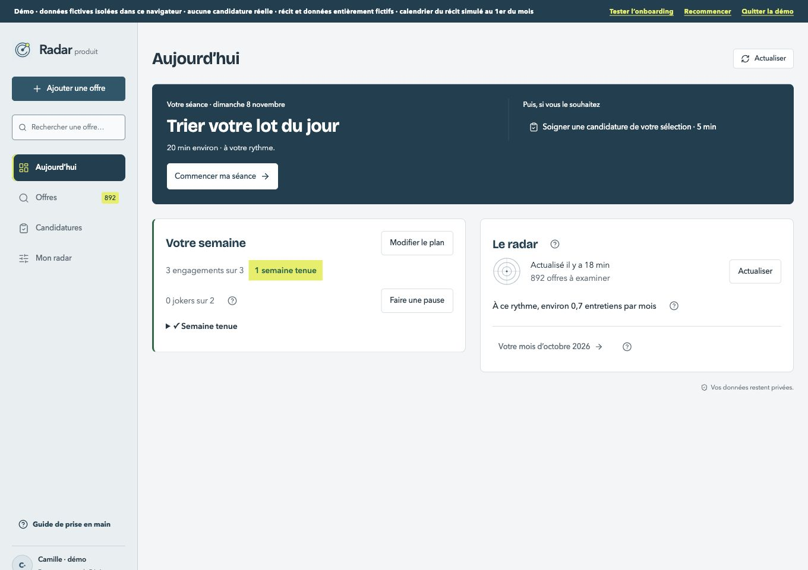

# Aujourd’hui — grille avant code

Références : [ordinateur](../maquettes/iteration-2/Aujourdhui-v2.html), [mobile 390 px faisant foi](../maquettes/iteration-2/Aujourdhui-mobile.html). Existant : staging 84. Les annotations décrivent des états qui remplacent les blocs, jamais une bande affichée.

| Format | Avant | Maquette |
| --- | --- | --- |
| Ordinateur 1360 px |  |  |
| Mobile 390 px |  |  |

1. [x] **En-tête et colonne** : reprendre l’en-tête horizontal déjà aligné sur Balayage, sur Aujourd’hui uniquement ; date et « Bonjour prénom » (40 px ordinateur / 28 px mobile), durée de la séance sur ordinateur. Mobile : date/titre et compte dans un seul en-tête blanc, sans recherche ni ajout ; barre Accueil/Offres/Suivi/Mon radar, cibles 44 px. Contenu 1120 px, marge 32 px ordinateur / 16 px mobile, blocs espacés de 20 / 14 px.
2. [x] **Séance** : titre 32 / 24 px, mention « Prochaine étape », bouton citron 52 px à droite sur ordinateur et pleine largeur sur mobile. Les deux étapes suivantes passent dessous : puces sur ordinateur, liste mobile. Le titre de tri décrit le lot réel et ses offres très proches. L’entretien sous 48 h garde sa priorité et précise la préparation de l’histoire proposée. Aucun changement de classement ni de durée calculée.
3. [x] **Semaine** : carte blanche rayon 16, titre et série sur une ligne, progression puis engagements compacts ; les tenus barrés sur ordinateur, repliés sur mobile, en attente visibles avec coche 44 px. Déplacer/modifier/pauses/jokers restent accessibles dans un repli de réglages ; aucun changement de sauvegarde ou de calcul de série. Sans plan, texte « Nouvelle semaine, page blanche » et action « Poser mes 3 engagements · 3 min », non bloquante ; rythme réellement ajustable de deux à quatre.
4. [x] **Radar** : titre et « Voir le bilan » alignés, dernière lecture et chiffres disponibles, sans grand radar décoratif animé ; synthèse de l’entonnoir séparée sur ordinateur, repliée sur mobile. Ne pas inventer un nombre depuis hier ou un total parcouru après rechargement : libellé explicite du dernier balayage / des offres à examiner. Le récit mensuel déjà livré reste accessible.
5. [x] **États alternatifs** : journée terminée = séance blanche, message « C’est tout pour aujourd’hui. Le radar veille. », aucun bouton dans ce bloc ; compte sans poste choisi = trois étapes de réglage (poste, trois sources, premier balayage), semaine/radar masqués ; chargement = squelettes aux dimensions finales, sans radar animé ; erreur de lecture = « Votre journée n’a pas pu être lue. Vos données sont intactes. » avec Réessayer. Panne d’une source/carnet = message local, autres blocs utilisables. Scénarios fictifs reproductibles pour capturer ces rendus, sans toucher aux comptes réels.
6. [x] **Cohérence et vérification** : rayons 20/16/10/999, interlettrage ≥−0,01em, couleurs Signal, un bouton principal par zone et une ligne d’aide par bloc, ≤120 mots ; captures avant/après/maquette de chaque état à 1360/390 ; clavier/focus et cibles 44 px ; tests/types verts, aucune nouvelle erreur ESLint, console vide, données fictives d’origine intactes ; guide, changelog et plan à jour, staging privé vérifié.

## Choix explicites

Le classement des prochaines étapes et les durées existants restent inchangés : la maquette illustre 12 minutes pour 20 offres, tandis que le calcul réel prévoit une minute par offre. Les compteurs et l’entonnoir ne sont jamais inventés. Le compte neuf est reconnu par l’absence de poste recherché, même si des exemples fictifs sont présents. Les actions de la semaine restent disponibles sans alourdir la carte principale. Le scénario « sans plan » couvre aussi le lundi sans simuler une date réelle dans le produit.

Composants réutilisés : navigation de Balayage, RadarAccountMenu, WorkspaceButton, WorkspacePanelHeader, WorkspaceState, SignalProgress, HelpTooltip, contrôles et sauvegarde du plan existants. Aucun nouveau contrôle natif isolé.

## Recette et choix vérifiés

Les comptes des scénarios sont entièrement fictifs et indépendants. Les états alternatifs sont servis par le staging privé via un relais limité à la boucle locale, sans changer sa visibilité. Le compte principal du staging reste sur son URL privée ; aucune réinitialisation ni recopie de données.

- `today-interview` : entretien sous 48 heures, bonne histoire ouverte, fermeture Échap, séance terminée blanche et sans bouton.
- `onboarding=1` : trois étapes, semaine et radar absents, première étape utilisable au clavier, premier balayage désactivé avant choix du poste.
- `today-error` : vraie vue de reprise du chargement, données conservées, Réessayer au clavier rétablit l’accueil.
- `today-loading` : lecture fictive ralentie de quatre secondes, squelettes statiques aux tailles des cartes.
- `today-partial` : une source réussit et l’autre échoue, accueil conservé, message local et bilan accessible avec reprise ciblée.
- `weeks-held` : engagements compacts, tenus barrés sur ordinateur et repliés sur mobile. Entrée déplie/replie ; Espace coche et enregistre. La dernière coche ouvre le moment « Semaine tenue », puis le focus revient au titre ; décocher restaure l’engagement et le focus le suit. Le réglage fictif a été rétabli à une coche sur deux.

Le compte principal contient 1 003 offres, 50 candidatures et deux documents fictifs. Comparaison stricte avant/après : profil, offres, fichiers, colonnes, plan, sources et repères identiques. Les preuves brutes restent hors dépôt public.

Contrôles : 425 tests réussis, types réussis, aucune nouvelle erreur ESLint (33 erreurs préexistantes inchangées). À 390 px : titres 28 / 24 / 20 px, interlettrage −0,01em, aucun débordement ; toutes les cibles de l’accueil et de ses réglages atteignent 44 px. Aucune annotation affichée. Console vide.

La maquette donne des exemples de chiffres et de dates ; les captures montrent les valeurs réelles du jeu fictif. Un plan de deux engagements reste autorisé, comme avant. Le lundi sans plan utilise le même état « Nouvelle semaine, page blanche » que les autres jours sans plan, sans simuler le calendrier.

## Livraison vérifiée

Staging privé **version 86**, source `55f5bbc2dbcc6a70ac0a5c1b22fb37ce198200ab`. Aucun changement de base, de stockage, de configuration ou de visibilité ; aucune production. Les commits suivants ajoutent uniquement les preuves documentaires.

Les états fonctionnels ont été capturés sur la version 85 ; la version 86 conserve leur code et finalise les rayons, les menus et la disposition tendance/récit. Les captures concernées (accueil complet, chargement, erreur, plan, rythme, calendrier et pause) ont été renouvelées sur 86. Les images ont été relues ; dimensions 1360 × 960 et 390 × 844.

[Comparaisons avant / après / maquette de chaque état](comparaison.html). La colonne Avant présente l’écran principal antérieur ; les états alternatifs sont nommés dans la colonne Après et décrits dans les annotations de la référence.

| État | Ordinateur 1360 px | Mobile 390 px |
| --- | --- | --- |
| Accueil complet | [Capture](apres-principal-ordinateur.jpg) | [Capture](apres-principal-mobile.jpg) |
| Engagements | [Capture](apres-semaine-ordinateur.jpg) | [Capture](apres-semaine-mobile.jpg) |
| Journée terminée | [Capture](apres-termine-ordinateur.jpg) | [Capture](apres-termine-mobile.jpg) |
| Entretien sous 48 h | [Capture](apres-entretien-ordinateur.jpg) | [Capture](apres-entretien-mobile.jpg) |
| Compte neuf | [Capture](apres-compte-neuf-ordinateur.jpg) | [Capture](apres-compte-neuf-mobile.jpg) |
| Semaine sans plan | [Capture](apres-sans-plan-ordinateur.jpg) | [Capture](apres-sans-plan-mobile.jpg) |
| Chargement | [Capture](apres-chargement-ordinateur.jpg) | [Capture](apres-chargement-mobile.jpg) |
| Erreur et reprise | [Capture](apres-erreur-ordinateur.jpg) | [Capture](apres-erreur-mobile.jpg) |
| Panne partielle | [Capture](apres-partiel-ordinateur.jpg) | [Capture](apres-partiel-mobile.jpg) |

Contrôles mobiles supplémentaires : [engagements dépliés](apres-engagements-deplies-mobile.jpg), [tendance et récit](apres-radar-mobile.jpg), [plan](apres-plan-mobile.jpg), [rythme](apres-rythme-mobile.jpg), [calendrier](apres-calendrier-mobile.jpg), [pause](apres-pause-mobile.jpg). Le calendrier se défile dans la hauteur disponible ; Fermer reste accessible au clavier. Retour de focus vérifié sans modifier le rythme, les dates ou la pause.

Après rechargement, le résultat détaillé d’un balayage n’est pas conservé en mémoire : « Actualiser » remplace alors « Voir le bilan ». Les dernières lectures restent décrites avec leurs chiffres enregistrés, sans reconstruire un faux bilan. Le récit mensuel déjà livré reste sous la tendance.

Dernier contrôle sur l’URL privée : console vide, mouvement réduit actif, aucun débordement mobile, aucune cible visible sous 44 px ; 35 mots dans les paragraphes visibles. Aucun écart non justifié dans la grille.
