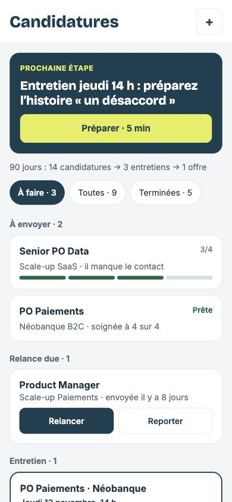
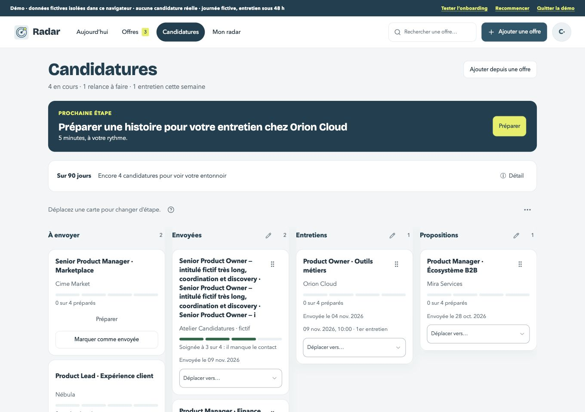
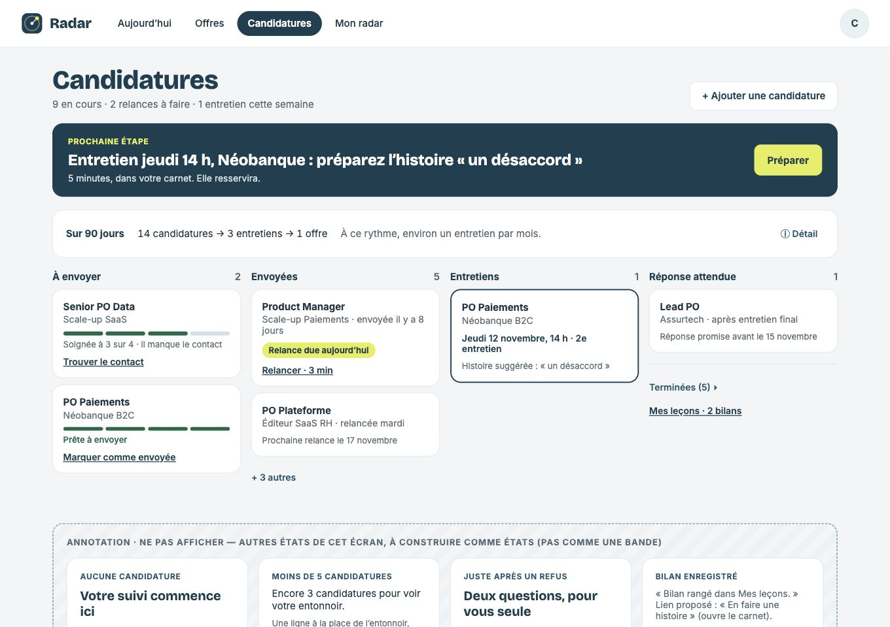
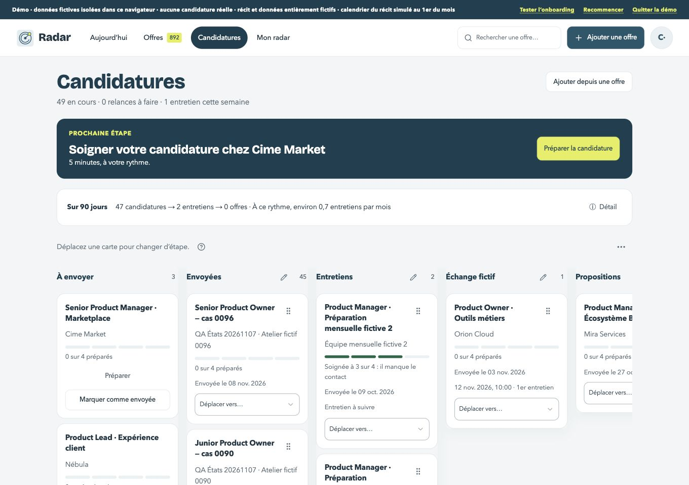
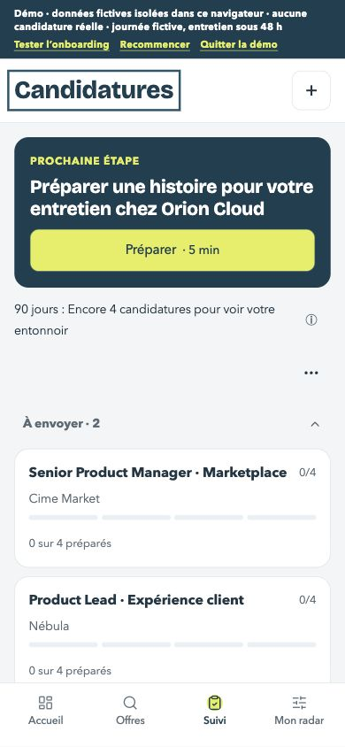

# C4 — Candidatures mobile : grille préalable

Avant : staging 101, captures de la recette #265, donc même code que main au début de ce lot. À 390 px, Candidatures-mobile.html fait foi. Les décisions C1–C5 restent prioritaires.

| Format | Avant | Maquette |
| --- | --- | --- |
| 390 px |  |  |
| 1360 px |  |  |

1. [x] En-tête blanc compact, titre 28 px et ajout en bouton + de 44 px ; retirer marque et recherche redondantes au-dessus. Garder les quatre entrées du bas, 52 px, libellés de la maquette.
2. [x] Liste compacte : À envoyer, relances dues, entretiens et attente ; préserver les vraies propositions et les colonnes personnelles. Deux cartes par groupe puis « + N autres ». Aucun statut ni ordre stocké réécrit par cette projection.
3. [x] Cartes 16 px, titre / entreprise lisibles, quatre repères réels pour la préparation ; une carte ouvre le dossier. Relancer / Reporter utilisent le dossier et son choix de date, sans envoi ni report automatique.
4. [x] Outils dans « … » : tags et ajout de colonne. Changer d’étape reste disponible, avec motif pour clore. Échec : dernier état conservé, bouton de reprise et focus explicite après confirmation.
5. [x] Fiche plein écran avec « ← Candidatures » ; prochaine action, quatre repères, dates et notes, composants existants. Reporter ouvre le réglage de date existant. Les autres rubriques du dossier restent accessibles.
6. [x] C1 : pas de nouveaux filtres Toutes / Terminées ; terminées repliées en bas, Mes leçons en lien et entonnoir compact avec ⓘ. Adapter le rythme et les aides, cibles 44 px et pas de débordement.
7. [x] États de la bande et régression : vide, seuil, refus facultatif, bilan enregistré, déplacement échoué / reprise, cinquante candidatures, textes longs, clavier et mouvement réduit. Captures avant / après / maquette dans les deux formats ; aucune annotation affichée.
8. [x] Tests et types verts, aucune nouvelle erreur ESLint, console vide, données conservées, guide / changelog / plan et staging privé à jour.

## Choix avant code

- Les puces « À faire / Toutes / Terminées » de la maquette ne réintroduisent pas les filtres expressément retirés par C1. Tous les groupes sont accessibles dans une seule liste, et les terminées restent repliées.
- Les groupes urgents sont une présentation des faits ; les colonnes personnelles et les propositions reçues gardent leur sens. Le modèle n’est pas transformé pour reprendre les exemples chiffrés de la maquette.
- Ajouter mène aux offres, comme sur ordinateur. Reporter ne choisit aucune date à la place de la personne : il ouvre le réglage existant. Les rubriques du dossier restent accessibles, tout en donnant priorité à l’action et aux quatre repères.

## Recette et choix justifiés

Code final `8bdcf6d`, staging privé 104. Les contrôles de données portent sur les mêmes comptes fictifs : 1 003 offres, 50 candidatures, deux fichiers et colonnes personnelles strictement identiques ; sur le petit compte, huit offres initiales, fichiers et colonnes identiques. Seule la candidature de recette a changé d’étape, puis a été remise en attente. Annuler Reporter ne modifie pas le rappel original.

- Deux cartes puis dépliage : 45 candidatures en attente affichées en deux cartes, puis toutes les 45 après « + 43 autres ». Colonne personnelle et proposition conservées ; terminées repliées.
- Erreur simulée 503 : étape inchangée, région d’erreur focalisée, reprise réussie vers Entretiens, focus sur la carte confirmée. Clôture avec motif obligatoire ; refus facultatif, bilan existant et lien Mes leçons conservés.
- Reporter ouvre le choix existant, dialogue 20 px ; annuler rend le focus à Modifier la date. Changer de rubrique ne le rouvre pas ; retour à la liste rend le focus à Reporter. Fiche bord à bord : rayon nul volontaire, comme une page mobile, et non une carte.
- Filtre : sélection du tag, fermeture du menu, jeton explicite permettant de retirer le filtre. Les contrôles fermés ne prennent plus de place ni de focus.
- Titre mobile 28 px, boutons et commandes 44 px au moins, barre du bas 52 px, aucun débordement. Le résumé des conversions tient sur une ligne ; détails et rythme restent dans ⓘ. Petit effectif : seuil réel issu du journal, sans reconstruire les envois anciens.
- 433 tests réussis, types verts ; aucune nouvelle erreur ESLint par rapport à main. Console sans erreur ni avertissement pendant la recette. Composants réutilisés : Signal, WorkspaceButton, ChoiceSelect, Collapsible, ApplicationCarePreview, dialogues de date et de clôture existants.
- Ordinateur : présentation par étapes et navigation commune conservées. Les états ordinateur dont le code n’a pas changé sont aussi documentés dans la recette #265 ; les nouvelles captures vérifient les collections vide et volumineuse.

Les filtres Toutes / Terminées de la maquette sont omis conformément à C1. « Propositions » et les colonnes personnelles ne sont pas renommées pour imiter des exemples de la maquette. Les annotations ne sont pas rendues. Le calendrier, les notes et les autres rubriques restent disponibles dans le dossier.

## Captures

| Format | Avant | Après | Maquette |
| --- | --- | --- | --- |
| 1360 px |  |  |  |
| 390 px |  |  |  |

| État | Ordinateur | Mobile |
| --- | --- | --- |
| Vide et seuil | [Capture](apres-vide-ordinateur.jpg) | [Capture](apres-vide-mobile.jpg) |
| Cinquante candidatures | [Capture](apres-cinquante-ordinateur.jpg) | [Compact](apres-cinquante-mobile.jpg) · [déplié](apres-deplie-mobile.jpg) |
| Dossier et textes longs | [Recette conservée](../alignement-candidatures/README.md) | [Dossier](apres-dossier-mobile.jpg) |
| Relance / choix de date | [Recette conservée](../alignement-candidatures/README.md) | [Reporter](apres-report-mobile.jpg) |
| Filtre | [Recette conservée](../alignement-candidatures/README.md) | [Outils](apres-outils-mobile.jpg) · [actif](apres-filtre-mobile.jpg) |
| Erreur puis reprise | [Recette conservée](../alignement-candidatures/README.md) | [Erreur](apres-erreur-mobile.jpg) · [reprise](apres-reprise-mobile.jpg) |
| Refus / bilan privé / terminées | [Recette conservée](../alignement-candidatures/README.md) | [Confirmation](apres-cloture-mobile.jpg) · [refus](apres-refus-mobile.jpg) · [bilan](apres-bilan-mobile.jpg) · [terminées](apres-terminees-mobile.jpg) |

Les captures d’erreur, de reprise et de bilan proviennent de la même recette sur les révisions 102–103 ; leur interface est inchangée dans la révision finale. Les comptes, le code source et les fichiers privés ne sont pas publiés.
