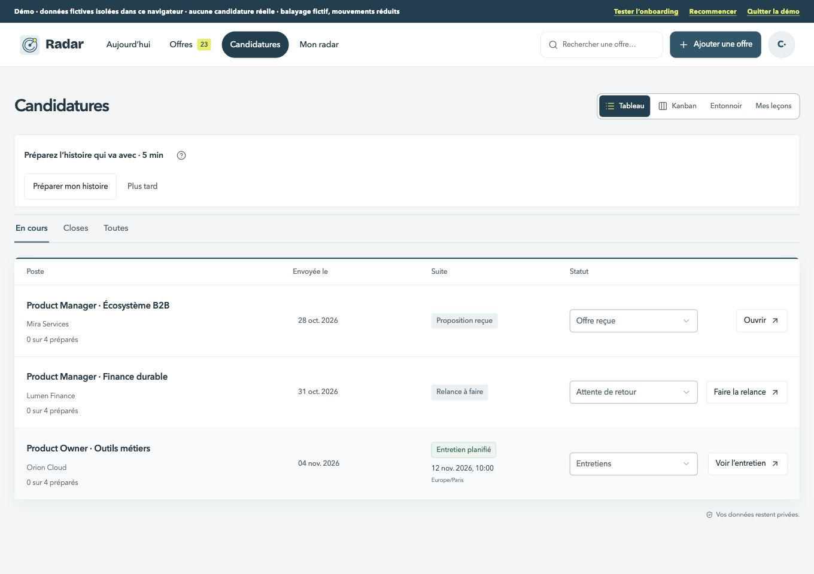
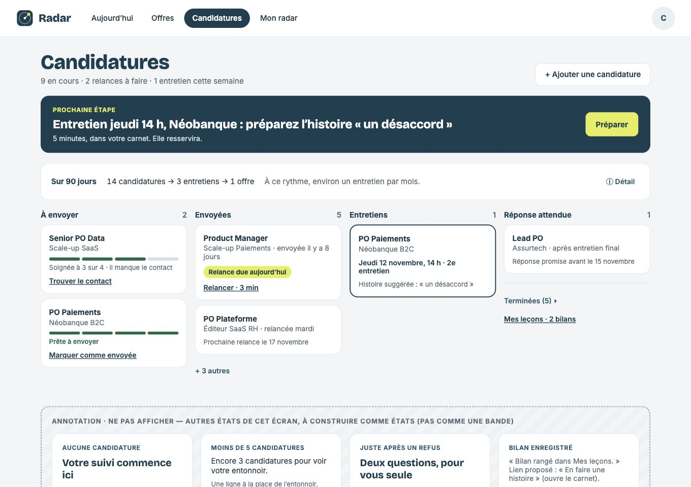
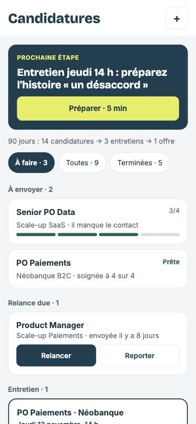

# Candidatures — décisions à intégrer à la grille préalable

Lot à commencer après Offres, A puis B. Les captures actuelles, les maquettes côte à côte et les autres écarts numérotés seront ajoutés à l’ouverture de la PR, avant le code. Références : Candidatures.html et Candidatures-mobile.html ; à 390 px, la maquette mobile fait foi.

- [ ] C1. Une seule vue par défaut : colonnes par étape. Retirer les onglets Tableau / Kanban / Entonnoir / Mes leçons et En cours / Closes / Toutes. Replier les closes en bas dans « Terminées (N) ▸ ». Une liste peut rester dans un petit sélecteur discret si utile.
- [ ] C2. Entonnoir en une ligne en haut, avec ⓘ pour le détail. Sous cinq candidatures : « Encore N candidatures pour voir votre entonnoir ».
- [ ] C3. « Mes leçons » devient un lien, pas un onglet.
- [ ] C4. Retirer le paragraphe d’instructions au-dessus des colonnes : une ligne au plus, détails en ⓘ. Déplacer « Filtrer par tag » et « Ajouter une colonne » dans « … ».
- [ ] C5. Afficher la prochaine étape et sa cible en haut, comme dans la maquette.

Ces décisions s’appliquent aux lots ordinateur et mobile. Préserver les données, colonnes personnalisées et comportements existants ; justifier tout conflit avec les maquettes dans la PR. États des bandes, clavier, focus, cibles 44 px, captures avant / après / maquette, tests et staging requis.

## Grille préalable — ordinateur

Captures avant du staging 99, à 1360 et 390 px. La PR ordinateur traite les commandes communes ; l’alignement visuel des groupes mobiles vient dans la PR suivante.

| Format | Avant | Maquette |
| --- | --- | --- |
| 1360 px |  |  |
| 390 px |  |  |

1. [ ] C1 : colonnes comme vue unique, aucune ancienne barre d’onglets ; terminées repliées en bas. Conserver les colonnes personnelles et leur ordre. Montrer « À envoyer » pour les offres sélectionnées non envoyées, sans les déclarer candidatures envoyées.
2. [ ] C2 : une ligne d’entonnoir sur 90 jours, seuil réel du journal et dialogue de détail accessible par ⓘ.
3. [ ] C3 : Mes leçons devient un lien et une sous-page avec retour.
4. [ ] C4 : une ligne d’aide, détails en ⓘ ; filtre par tag et ajout de colonne dans « … ». Déplacement accessible sur chaque carte ; motif de clôture conservé.
5. [ ] C5 : prochaine étape réelle et nommée, issue de la file existante, au-dessus des colonnes ; pas de tâche inventée quand aucune n’est due.
6. [ ] Hiérarchie de la maquette : titre 40 px / 28 px, contenu sur une colonne commune, cartes 16 px, contrôles 10 px / 44 px ; quatre repères de préparation et dates réelles. Trois cartes par colonne puis « + N autres ».
7. [ ] États de la bande : vide avec accès au lot, seuil de cinq, bilan facultatif après refus, bilan enregistré et lien vers carnet, déplacement échoué et reprise sans perte, cinquante candidatures. Aucun bloc d’annotation affiché.
8. [ ] Captures avant / après / maquette ordinateur et mobile, textes longs, clavier / focus, absence d’erreur console et de nouvelle erreur ESLint ; tests, types, données et staging privé vérifiés.

### Choix avant code

- Les étapes conservées sont celles du modèle et des colonnes personnelles. « Propositions » ne devient pas « Réponse attendue » : une offre reçue ne doit pas changer de sens pour copier un exemple. « À envoyer » est une vue des offres sélectionnées ; leur envoi reste une déclaration explicite.
- La commande d’ajout mène aux offres, comme le flux existant ; son texte précise « Ajouter depuis une offre » plutôt que de promettre un envoi automatique.
- Les chiffres de l’entonnoir restent ceux du journal : les dossiers historiques sans événement ne sont pas reconstitués. Les nombres et entreprises de la maquette sont des exemples.
- Pour l’échec d’un déplacement, on conserve le dernier état confirmé. On ne promet pas « Rien n’a changé » si une réponse réseau a été perdue ; la reprise est explicite.
