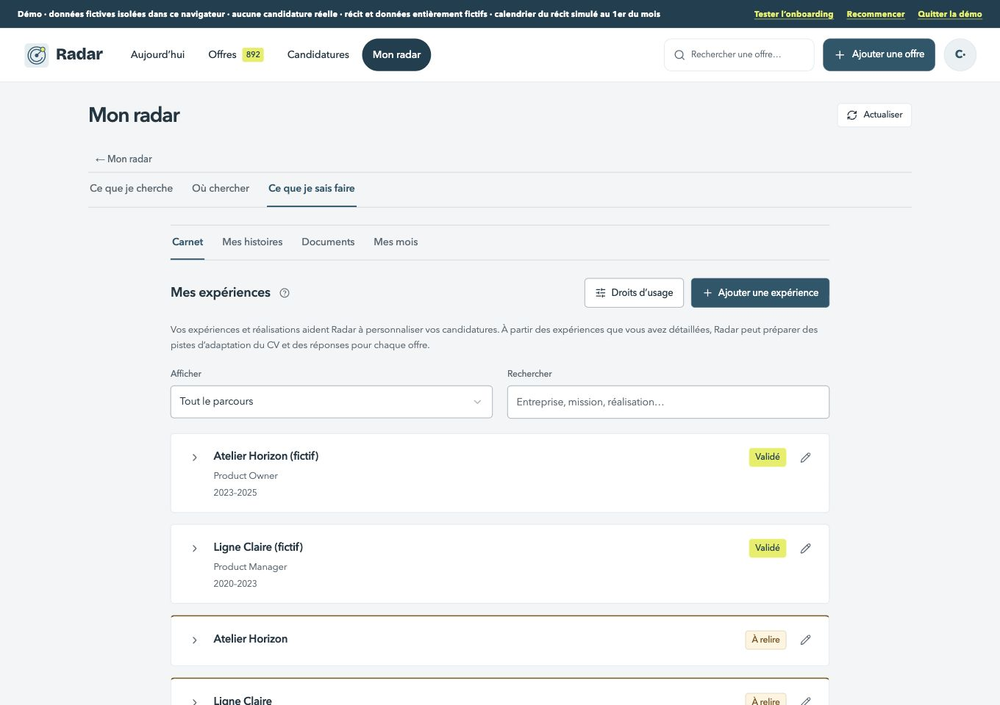
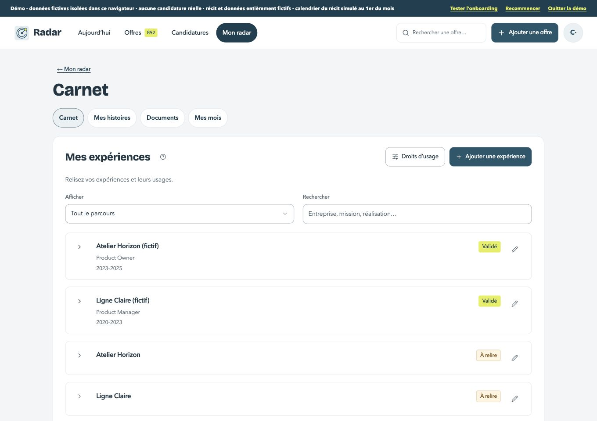
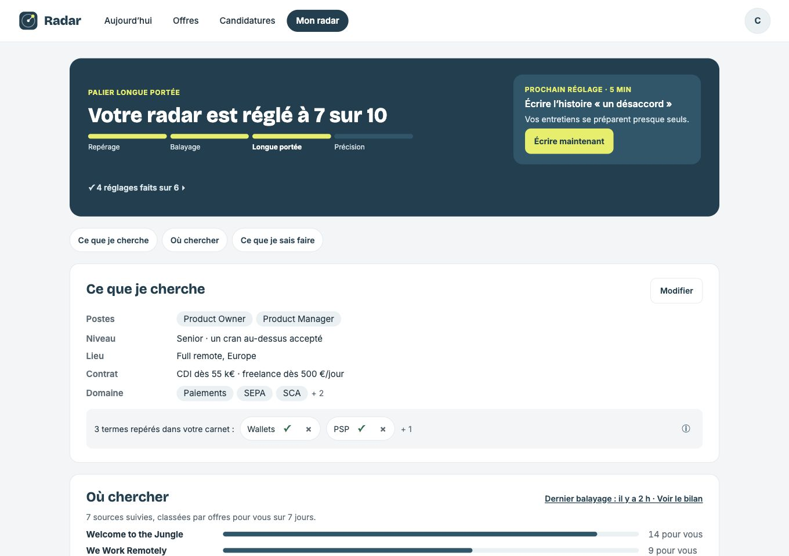
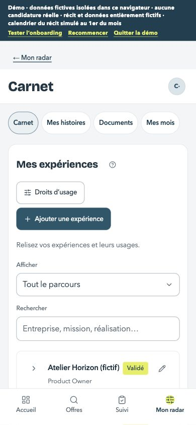
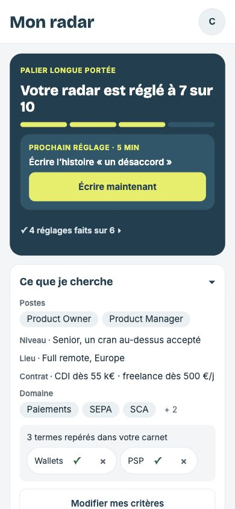

# Carnet détaillé — grille et recette

Existant : staging 111, main après #268. Pas de maquette dédiée à ces sous-vues : les références communes servent pour la colonne, les surfaces, les titres et les contrôles. Le carnet, les droits et les fichiers restent inchangés.

| Format | Avant | Après | Référence Signal |
| --- | --- | --- | --- |
| 1360 px |  |  |  |
| 390 px |  |  |  |

1. [x] Retour « ← Mon radar », titre de la sous-vue et contenu sur la même colonne. Une seule navigation de sous-vues : Carnet, Mes histoires, Documents, Mes mois. Retirer les doublons et le raccourci de balayage hors contexte ; l’actualisation des offres reste disponible dans Mon radar. En-tête mobile 28 px, compte, quatre entrées basses 52 px.
2. [x] Carnet : titres 24 / 20 pour les sections, surfaces 16, cartes et contrôles 10 / 999, grands panneaux / dialogues 20. Aide visible courte, détail dans ⓘ. États du carnet : lecture, vide, filtré, validé / à relire, ouvert, texte long, ajout / modification, erreur et reprise.
3. [x] Droits, consentement et confirmation de masquage : mêmes décisions et limites, contrôles tactiles, focus et retour. Remplacer le sélecteur natif de doublon par ChoiceSelect existant. Ne modifier aucun droit du compte principal.
4. [x] Histoires : lecture et état de thèmes, éditeur Signal, mouvement réduit et clavier. Ne modifier ni les huit thèmes ni leur validation.
5. [x] Documents : mêmes fichiers / choix d’import, cartes et boutons alignés ; vide, liés et erreur. Mes mois : archive lisible et état vide ; récit plein écran conservé. Aucun transfert, suppression ni écrasement des fichiers pour cette recette.
6. [x] Captures avant / après et références à 1360 / 390 px ; clavier, focus, cibles de 44 px, aucune nouvelle erreur ESLint, tests / types verts, console vide et données fictives identiques. Guide, changelog, plan et staging privé vérifiés, puis fusion.

Les avertissements de consentement et masquage restent visibles. Les éditeurs, sauvegardes, documents de référence et adresses existantes sont réutilisés. Les annotations des maquettes restent documentaires.

Version privée **113**, source Sites `dd19a44b1c5c7c26d6e496cc02819e8a5738c173`. Captures des états inchangés entre les versions 112 et 113 ; les captures d’erreur et de reprise correspondent à la version finale.

| État | 1360 px | 390 px |
| --- | --- | --- |
| Expérience ouverte | [Avant](avant-ouvert-ordinateur.jpg) · [Après](apres-experience-ordinateur.jpg) | [Avant](avant-ouvert-mobile.jpg) · [Après](apres-experience-mobile.jpg) |
| Ajout / modification | [Ajout](apres-ajouter-ordinateur.jpg) · [Modifier](apres-modifier-ordinateur.jpg) | [Ajout](apres-ajouter-mobile.jpg) · [Modifier](apres-modifier-mobile.jpg) |
| Texte long et recherche | [Texte long](apres-texte-long-ordinateur.jpg) · [Filtre](apres-filtre-ordinateur.jpg) | [Texte long](apres-texte-long-mobile.jpg) · [Filtre](apres-filtre-mobile.jpg) |
| Carnet vide / erreur / reprise | [Vide](apres-vide-ordinateur.jpg) · [Erreur](apres-erreur-ordinateur.jpg) · [Reprise](apres-reprise-ordinateur.jpg) | [Vide](apres-vide-mobile.jpg) · [Erreur](apres-erreur-mobile.jpg) · [Reprise](apres-reprise-mobile.jpg) |
| Droits et doublon | [Avant](avant-droits-ordinateur.jpg) · [Droits](apres-droits-ordinateur.jpg) · [Doublon](apres-doublon-ordinateur.jpg) | [Avant](avant-droits-mobile.jpg) · [Droits](apres-droits-mobile.jpg) · [Doublon](apres-doublon-mobile.jpg) |
| Histoires et éditeur | [Avant](avant-histoires-ordinateur.jpg) · [Après](apres-histoires-ordinateur.jpg) · [Éditeur](apres-editeur-histoire-ordinateur.jpg) | [Avant](avant-histoires-mobile.jpg) · [Après](apres-histoires-mobile.jpg) · [Éditeur](apres-editeur-histoire-mobile.jpg) |
| Documents | [Avant](avant-documents-ordinateur.jpg) · [Liés](apres-documents-lies-ordinateur.jpg) · [Vide](apres-documents-vides-ordinateur.jpg) · [Erreur](apres-documents-erreur-ordinateur.jpg) | [Avant](avant-documents-mobile.jpg) · [Chargement](apres-documents-mobile.jpg) · [Liés](apres-documents-lies-mobile.jpg) · [Vide](apres-documents-vides-mobile.jpg) · [Erreur](apres-documents-erreur-mobile.jpg) |
| Mois et récit | [Avant](avant-mois-ordinateur.jpg) · [Archive](apres-mois-ordinateur.jpg) · [Zéro activité](apres-mois-zero-ordinateur.jpg) · [Récit](apres-recit-ordinateur.jpg) | [Avant](avant-mois-mobile.jpg) · [Archive](apres-mois-mobile.jpg) · [Zéro activité](apres-mois-zero-mobile.jpg) · [Récit](apres-recit-mobile.jpg) |

- Sur le compte de recette séparé, une expérience fictive au titre long s’enregistre et s’ouvre. La recherche l’isole. Le compte fictif principal conserve exactement les offres, candidatures, fichiers, expériences, droits, profil, sources et journal.
- Les droits s’ouvrent au clavier ; Échap rend le focus à l’action d’origine. Le sélecteur du doublon reste dans le dialogue, y compris son tiroir mobile ; un choix permet de confirmer, puis l’annulation ne masque rien. Le dialogue de consentement existant conserve ses décisions ; l’ajout manuel validé ne l’ouvre pas, et il n’a pas été déclenché lors de cette recette.
- Les lectures des documents et du carnet reprennent après un 503 simulé, avec retour du focus au titre. À 390 px, pas de débordement ; les commandes de la vue principale atteignent 44 px. Les titres de page mesurent 40 / 28 px. L’aide tient dans le plafond de 120 mots, les avertissements restent visibles dans leur contexte. L’archive d’un compte sans faits affiche le mois à zéro selon le calcul existant.
- `npm test` : 435 réussis. TypeScript sans erreur ; pas de nouvelle erreur ESLint ; console vide. Aucun fichier transféré, supprimé ni écrasé.
