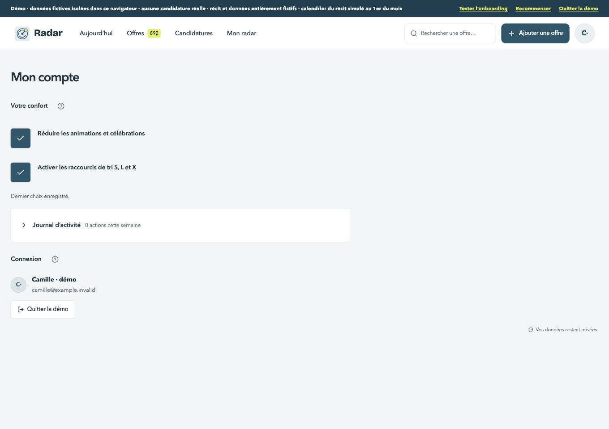
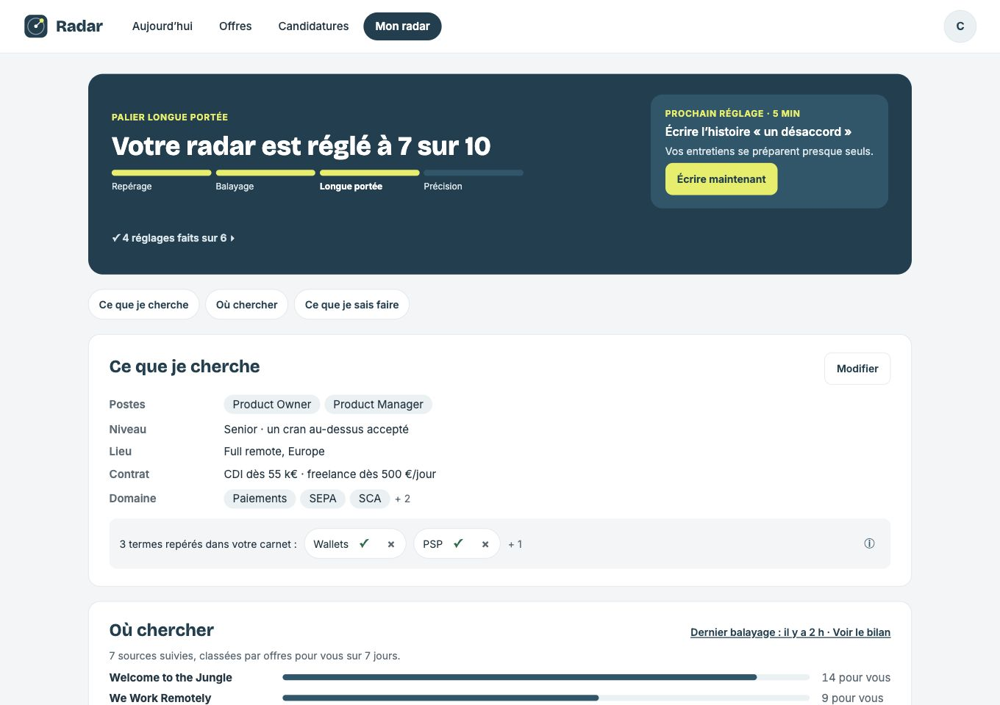
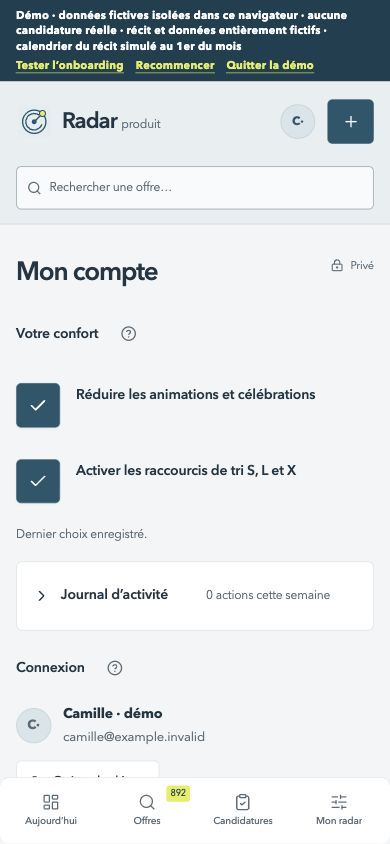
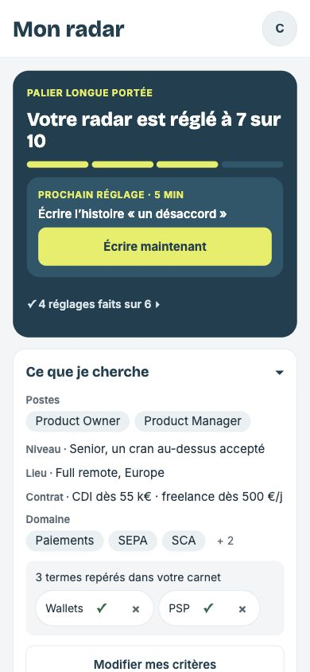
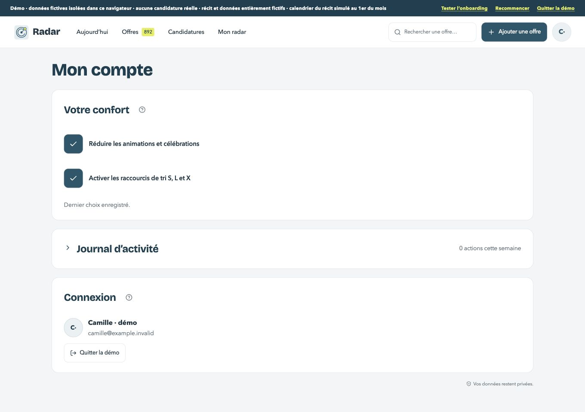
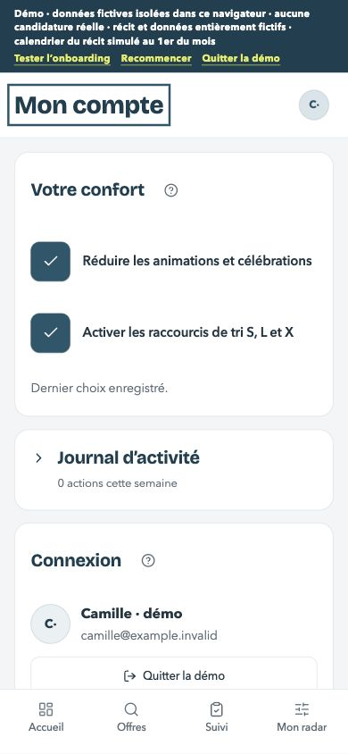

# Mon compte — grille avant code

Existant : staging 109, main après #267. Pas de maquette dédiée au compte : les références ci-dessous servent uniquement pour les composants, les espacements et les règles Signal. Le contenu et les comportements du compte restent conservés.

| Format | Avant | Référence commune |
| --- | --- | --- |
| 1360 px |  |  |
| 390 px |  |  |

1. [x] Même colonne pour titre et contenu, titre 40 px au plus / 28 px mobile ; en-tête mobile blanc avec compte, sans marque et recherche redondantes. Quatre entrées basses de 52 px, libellés cohérents.
2. [x] Cartes de confort, journal et connexion en surface blanche, rayon 16 et espacements communs ; titres de section en h2, sans saut de hiérarchie. Aucun fond sombre ajouté.
3. [x] Boutons et champs 10, informations et cases de 44 px, filtres en pastilles 999, focus visible ; mêmes couleurs et désactivations Signal. Avertissement irréversible maintenu visible.
4. [x] Journal replié, lecture, vide / filtre vide, données et pagination, texte long, erreur et reprise : mêmes contrôles, surfaces et densité. Ne modifier ni calcul, ni filtres, ni historique.
5. [x] Préférences : conserver leur enregistrement explicite à chaque case, le dernier état confirmé en cas d’erreur, la reprise et le mouvement réduit. Tester les choix sur un compte fictif dédié puis les restaurer.
6. [x] Connexion, export et suppression : garder les parcours existants, vérifier les contrôles accessibles et le dialogue sans soumettre de suppression ni restauration. La démo cache volontairement les actions de données du compte connecté. Aucune identité ou donnée personnelle dans les preuves publiques.
7. [x] Captures avant / après et références sur ordinateur / mobile, clavier et focus, 44 px, console vide, aides ≤ 120 mots, données fictives intactes, tests / types verts et aucune nouvelle erreur ESLint ; guide, changelog, plan, staging privé et fusion.

## Choix avant code

- Les avertissements de suppression restent visibles même s’ils occupent plusieurs lignes : le caractère irréversible ne doit pas être dissimulé dans une information.
- Les réglages de confort gardent leur comportement immédiat, distinct du niveau visé validé avec Terminé.
- La démo garde ses protections et son identité fictive ; le dialogue de suppression ne sera jamais soumis pendant cette recette.

## Résultat et recette

Staging privé 111, code `4cb5920`. À 1360 px, titre 40 px et même colonne que les cartes ; à 390 px, titre 28 px, barre du bas 52 px et cibles vérifiées à 44 px au moins. Aucun débordement, console sans erreur ni avertissement. Les titres de section utilisent h2. Les cartes, boutons, filtres et dialogue reprennent les rayons Signal 16 / 10 / 999 / 20 et les contrôles existants.

- Journal : ouverture au clavier, lecture, zéro action, filtre vide, vingt puis quarante actions, titre fictif de 180 caractères, erreur et réessai. Focus sur le filtre après reprise et sur la première action ajoutée après pagination.
- Préférences : lecture, erreur avec cases désactivées et dernier état confirmé, reprise vers le premier réglage, confirmation réelle de deux changements au clavier. Les choix effectifs du compte dédié sont rétablis ; le compte principal n’a pas été modifié.
- Le compte principal fictif reste strictement identique : profil, 1 003 offres, 50 candidatures, deux fichiers, carnet, sources et colonnes ; le journal relu est identique. Aucune migration ni production.
- 435 tests et types verts, aucune nouvelle erreur ESLint. Aides courtes et informations accessibles ; la mise en garde irréversible reste visible.
- La sauvegarde est vérifiée en lecture sur le staging. Le dialogue hors démo est contrôlé sur une identité locale fictive, car le staging en démo masque volontairement ces actions. Annuler reçoit le focus, la confirmation est désactivée jusqu’à la saisie exacte, Échap ferme et rend le focus au déclencheur. Aucun export, effacement, rétablissement ou changement d’identité du staging n’a été effectué.

## Captures

| Format | Avant | Après sur staging | Référence Signal |
| --- | --- | --- | --- |
| 1360 px |  |  |  |
| 390 px |  |  |  |

| État | Ordinateur | Mobile |
| --- | --- | --- |
| Lecture initiale | [Capture](apres-lecture-ordinateur.jpg) | [Capture](apres-lecture-mobile.jpg) |
| Journal ouvert | [Avant](avant-journal-ordinateur.jpg) · [après](apres-journal-ordinateur.jpg) | [Avant](avant-journal-mobile.jpg) · [après](apres-journal-mobile.jpg) |
| Vide et filtre vide | [Vide](apres-vide-ordinateur.jpg) · [filtre](apres-filtre-vide-ordinateur.jpg) | [Vide](apres-vide-mobile.jpg) · [filtre](apres-filtre-vide-mobile.jpg) |
| Pagination | [Capture](apres-pagination-ordinateur.jpg) | [Capture](apres-pagination-mobile.jpg) |
| Libellés longs | [Capture](apres-long-ordinateur.jpg) | [Capture](apres-long-mobile.jpg) |
| Erreurs de lecture | [Capture](apres-erreur-ordinateur.jpg) | [Capture](apres-erreur-mobile.jpg) |
| Préférences confirmées | [Capture](apres-enregistre-ordinateur.jpg) | [Capture](apres-enregistre-mobile.jpg) |
| Sauvegarde en lecture | [Avant](avant-export-ordinateur.jpg) · [après](apres-export-ordinateur.jpg) | [Avant](avant-export-mobile.jpg) · [après](apres-export-mobile.jpg) |
| Compte fictif local, dialogue | [Compte](compte-fictif-local-ordinateur.jpg) · [dialogue activable](dialogue-fictif-local-ordinateur.jpg) | [Compte](compte-fictif-local-mobile.jpg) · [dialogue désactivé](dialogue-fictif-local-mobile.jpg) |

Les captures de pagination et de confirmation sont prises pendant la recette de la version 110 ; ces états fonctionnels sont identiques dans la version 111. Les captures principales, de lecture, d’erreur, de vide et de textes longs proviennent de la version finale.
