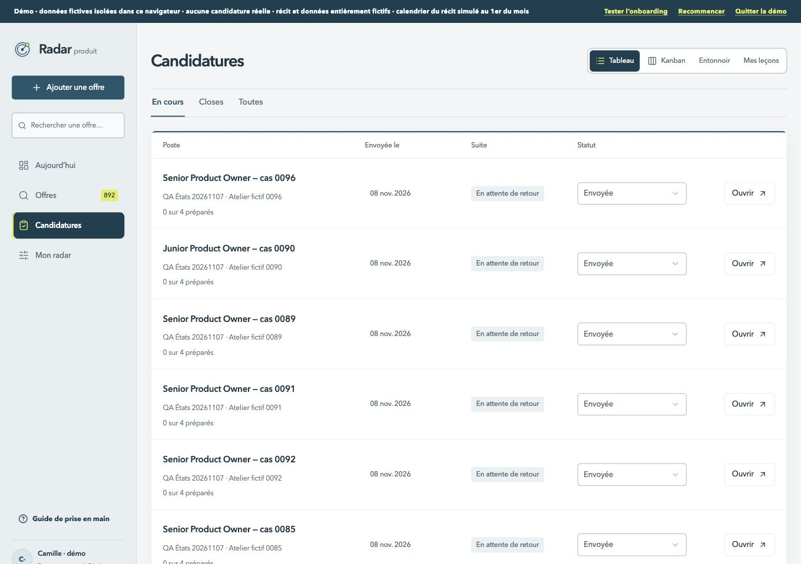
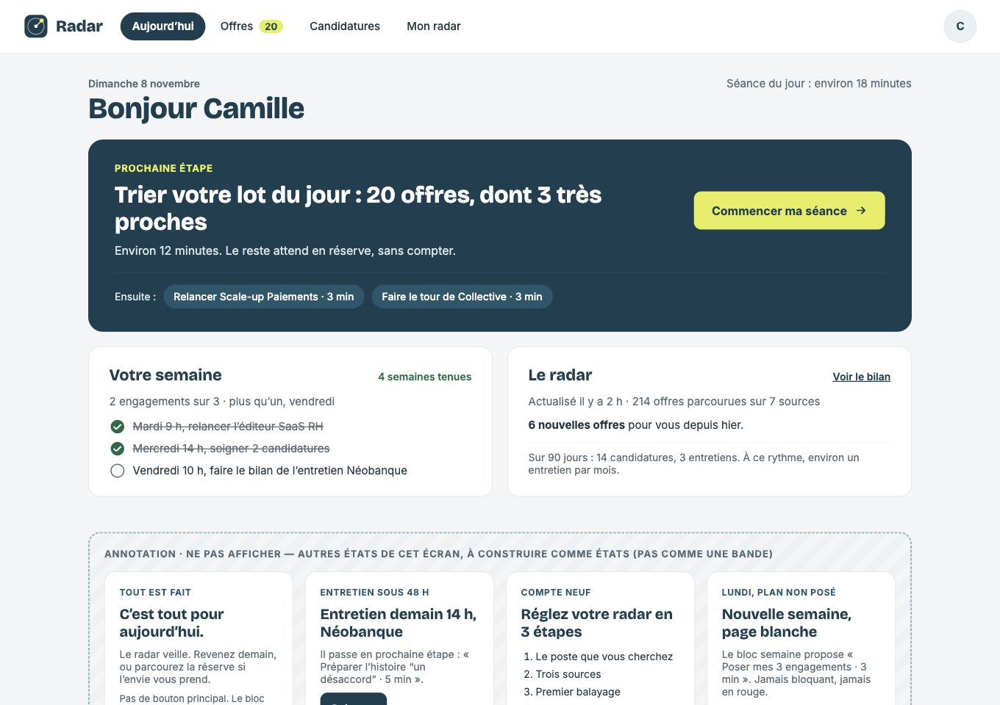
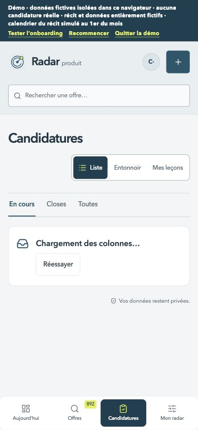
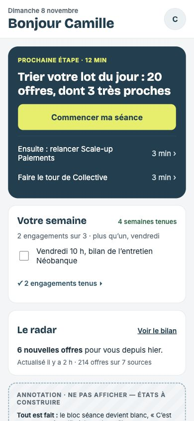

# A — Menu horizontal partout : grille préalable

Décision de l’utilisatrice du 8 novembre. Un seul lot transversal de navigation, avant B. Référence : en-tête des maquettes de l’itération 2. À 390 px, la navigation du bas à quatre entrées reste inchangée.

## Écarts à coder

1. [ ] Aujourd’hui, Offres et Balayage ont un en-tête horizontal, Candidatures / Mon radar / Mon compte une barre latérale : fournir le même en-tête horizontal sur tous les écrans d’ordinateur.
2. [ ] Placer Aujourd’hui, Offres, Candidatures et Mon radar dans cet ordre ; à droite, la recherche, Ajouter une offre, puis l’avatar. Réutiliser la recherche et ses règles existantes, le dialogue d’ajout et RadarAccountMenu.
3. [ ] Retirer la barre latérale sur ordinateur, conserver les quatre entrées mobiles et la fiche Offres mobile plein écran. Les tailles intermédiaires gardent les quatre libellés dans l’en-tête, avec commandes compactes si nécessaire.
4. [ ] Sur ordinateur, supprimer le doublon de recherche / ajout replié d’Offres ; le conserver sur mobile. Le clavier suit l’ordre visible et le retour après effacement de recherche vise le champ visible.
5. [ ] L’avatar propose Mon compte et le guide sur chaque écran ; vérifier ouverture, clavier, focus et ajout sans écriture involontaire.
6. [ ] Le guide cible le menu effectivement visible, y compris après changement de largeur, en démo et pendant l’onboarding.
7. [ ] Captures avant / après / maquette à 1360 et 390 px pour les écrans ; vérifier les quatre destinations, le compte, le balayage, les sous-vues, la démo et le guide. Aucune modification des comportements métiers ou données.
8. [ ] Tests et types verts, aucune nouvelle erreur ESLint, console sans erreur, cibles mobiles 44 px, composants et rayons Signal, staging privé vérifié.

## Comparaison préalable

Captures du staging 94 avant le code. Les commandes du compte et le dialogue d’ajout sont conservés.

| Format | Menu actuel dans Candidatures | Menu de référence |
| --- | --- | --- |
| 1360 px |  |  |
| 390 px |  |  |

Les captures avant couvrent aussi Aujourd’hui, Offres, Mon radar, Mon compte, Balayage et le menu de l’avatar, dans les deux formats. Les annotations des maquettes ne sont pas des éléments d’interface. Les commandes du compte et le dialogue d’ajout sont conservés. La recherche ouvre déjà Offres : sa logique est réutilisée.

## Résultat

À compléter après réalisation et recette.
