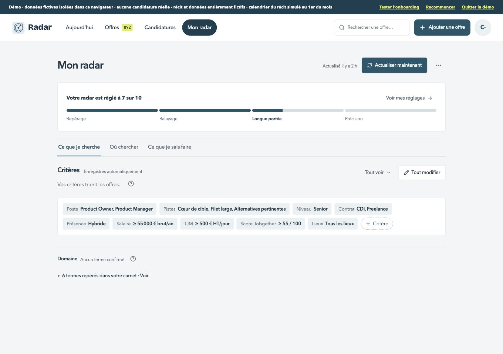
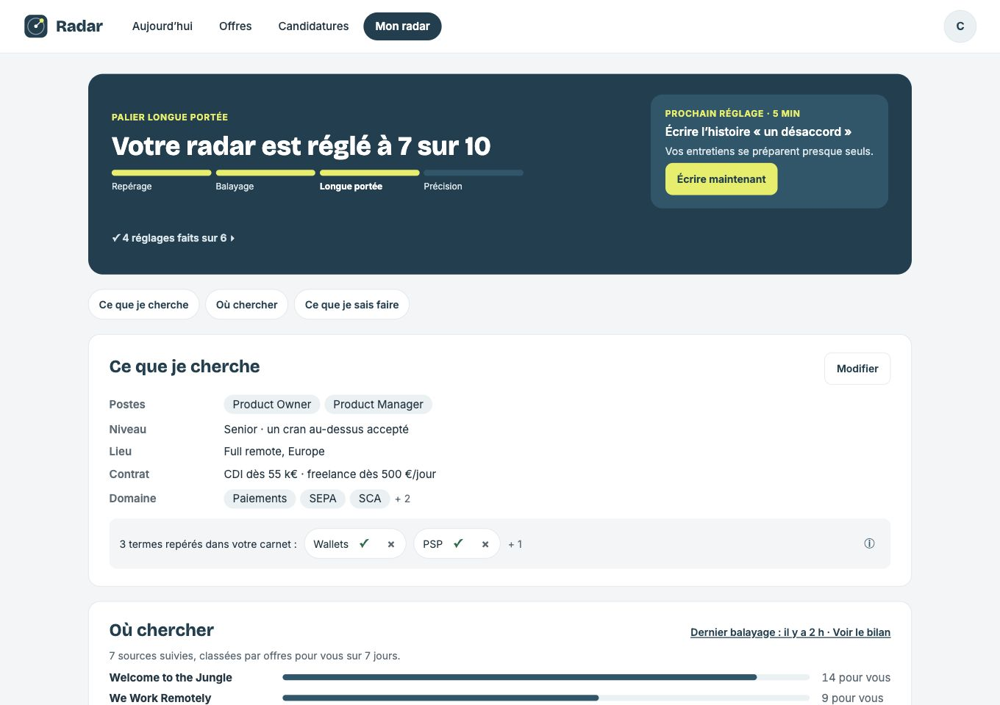
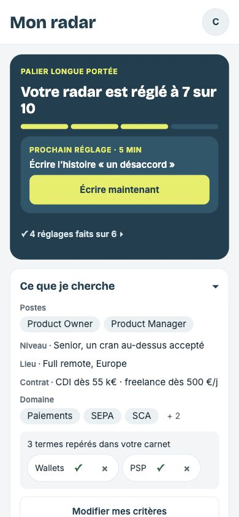
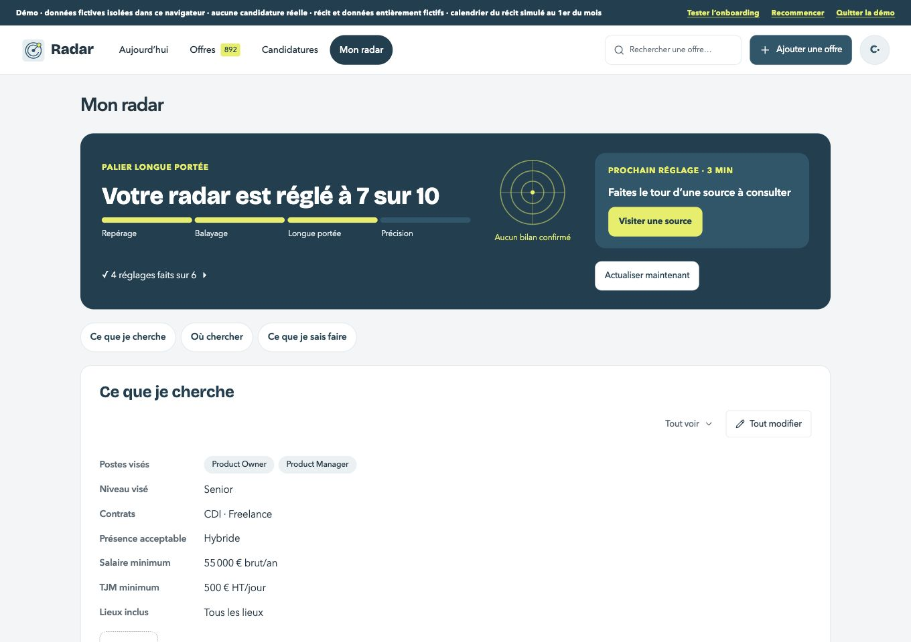

# Mon radar — grille préalable

Avant : staging 104, main après #266. Références MonRadar.html et MonRadar-mobile.html ; à 390 px la version mobile fait foi. Les décisions D1–D4 priment sur les exemples de la maquette.

| Format | Avant | Maquette |
| --- | --- | --- |
| 1360 px |  |  |
| 390 px |  |  |

1. [x] D1 : portée sombre, titre « Votre radar est réglé à N sur 10 », quatre paliers, prochain réglage et bouton principal ; détail des réglages faits replié. 0 : champ du poste dans l’en-tête ; 10 : précision atteinte sans prochain réglage. Lecture partielle : faits sûrs, aucun réglage proposé et reprise.
2. [x] D1 : radar fixe, sans balayage ni pulsation, avec les échos du dernier résultat confirmé ; clic vers le bilan. Conserver ce résultat dans la session du compte pour le retour et le rechargement. Sans résultat confirmé : radar vide et bilan indisponible expliqué, jamais d’échos inventés.
3. [x] D2 : actualisation secondaire. Un seul bouton principal dans la zone de portée : prochain réglage. Conserver l’actualisation silencieuse à l’ouverture.
4. [x] Structure : trois sections visibles sur ordinateur, pastilles vers leurs titres ; accordéon unique sur mobile, conservé au retour. En-tête blanc, compte, titre 28 px et navigation basse 52 px à 390 px. Les écrans détaillés restent accessibles par des liens explicites et les anciennes adresses. Le guide vise le champ du poste, les sections et les documents visibles de ce nouvel aperçu (complément observé pendant la recette, publié dans la PR avant correction).
5. [x] Critères résumés par lignes poste / niveau / présence / contrats et rémunération, puis termes en puces ; éditeurs existants accessibles. D3 : Pistes et Score Jobgether retirés des jetons, conservés dans Tout modifier. D4 : domaine vide aligné à gauche, « Aucun terme confirmé · Ouvrir mon carnet », vrai lien.
6. [x] Où chercher : trois sources puis dépliage, barres et chiffres alignés, pauses repliées, visites limitées et source nommée ; accès aux détails / ajout. Les barres décrivent les offres présentes si aucun historique fiable sur sept jours n’existe ; pas de statistique inventée.
7. [x] Ce que je sais faire : cartes Carnet / Histoires / Documents, chiffres réels, liens vers les détails ; Mes mois reste accessible. Préserver carnet, validations, thèmes, documents et critères.
8. [x] États de la bande : compte neuf, portée 10, termes ignorés et restauration, propositions après expérience, lecture partielle ; états ouverts / repliés, clavier, focus, mouvement réduit et textes longs. Aucune annotation rendue. Captures avant / après / maquettes dans les deux formats.
9. [x] Tests / types verts, aucune nouvelle erreur ESLint, console vide, cibles 44 px, aide ≤ 120 mots, données fictives intactes, guide / changelog / plan à jour, staging privé vérifié et fusion.

## Choix avant code

- Le fond sombre de Portée est explicitement demandé (D1). Le radar n’est pas animé et ne simule aucun résultat.
- La page devient un aperçu à trois sections ; les réglages complets, les sources détaillées et le carnet restent des sous-vues. Les liens existants continuent à ouvrir leur destination.
- Le compte neuf mobile garde les trois accordéons fermés, conformément à sa maquette ; le champ du poste reste immédiatement disponible dans l’en-tête.
- Les statistiques de sources indiquent leur période réellement disponible. Les résultats de balayage restent locaux à la session et isolés par compte ; aucun changement de format des données enregistrées.

## Résultat et limites justifiées

PR #267. Code applicatif final `ff25866`, staging privé 109. Les états ont été construits et vérifiés avec le même parcours sur les révisions 106–109 ; les captures finales de l’aperçu et de la cible tactile utilisent la dernière révision.

- Portée calculée par le modèle existant : une portée à sept sur dix pour le compte principal, zéro et dix sur deux comptes fictifs dédiés. Quatre paliers, prochain réglage seul principal, actualisation secondaire. À dix : aucune proposition ; à zéro : poste dans l’en-tête et trois accordéons fermés sur mobile.
- Lecture partielle simulée : sept points connus, aucune proposition incertaine, critères et dernier bilan conservés ; Réessayer relit les sources et rend le focus à la portée. La même confirmation rend le focus après le premier poste.
- Premier poste et Senior enregistrés avec Terminé. Senior reste absent de l’API tant que Terminé n’est pas cliqué ; après confirmation, il apparaît dans le résumé et le focus revient à + Critère. Les CTA de notification restent retirés.
- Actualisation à l’ouverture réellement testée en démo : la page reste Mon radar, sans ouvrir le balayage. Dix-sept échos confirmés, sans animation, conservés après rechargement. Le bilan relu annonce les sources terminées / en erreur, et conserve sa commande Actualiser. Retour vers l’aperçu avec focus sur le titre.
- Accordéon unique conservé après rechargement ; ouverture au clavier, titres sur la même colonne, 1360 / 390 px sans débordement. Titre mobile 28 px ; informations, commandes et liens de 44 px au moins, barre du bas conservée. Aides courtes ; le détail reste dans les informations et sous-vues.
- Terme ignoré puis restauré ; terme confirmé puis retiré ; choix remis dans leur état initial sur le compte dédié. Le domaine vide contient un vrai lien de carnet, aligné à gauche.
- Tout modifier conserve les pistes et ouvre directement le réglage Jobgether après le changement de section ; aucune valeur n’est modifiée pour cette vérification.
- Guide : champ du poste mis en lumière, enregistrement, passage à Ce que je sais faire et accès Documents. Les étapes et les données ne sont pas remplacées.
- 435 tests et types verts. Deux tests supplémentaires couvrent le bilan relu, les échos inconnus, les sessions distinctes et les données invalides. Aucune nouvelle erreur ESLint : diagnostics préexistants inchangés. Console sans erreur ni avertissement dans la recette finale, y compris après rechargement et conservation de l’accordéon.
- Données du compte principal fictif comparées intégralement : 1 003 offres / 50 candidatures, deux fichiers, profil, sources, carnet et colonnes strictement identiques. Les comptes zéro / dix sont isolés et fictifs ; le balayage de recette a ajouté ses offres à son seul compte dédié. Aucun fichier de production, aucune migration, aucune production.

Composants réutilisés : SignalRadar fixe, SignalProgress, WorkspaceButton, éditeurs de critères et de niveau, termes / informations, carnet, documents et guide existants. Le bilan de session est facultatif, validé avant lecture et séparé par compte ; aucune donnée n’est envoyée à un service tiers.

### Choix motivés

- Les barres comparent les **offres présentes selon les critères**, et non un historique de sept jours que les données disponibles ne permettent pas de garantir.
- Carnet indique les expériences validées, Histoires les récits préparés, Documents les références liées au profil. Les détails restent dans leurs sous-vues ; leur alignement visuel complet est prévu aux lots g2 / g3 du plan.
- La proposition « Radar a repéré… / Tout ajouter / Choisir / Plus tard » reste attachée à l’expérience validée dans son carnet, afin de conserver sa provenance et son contexte. L’aperçu affiche les mêmes termes en puces confirmables. Cet état existant est capturé dans la sous-vue correspondante.
- Le dernier bilan est celui confirmé dans la session de ce compte. Un nouvel onglet sans bilan reste vide : aucune reconstitution ni écho inventé. Les échos conservés ne sont jamais présentés comme une lecture en cours.
- Les annotations des maquettes ne sont pas affichées.

## Comparaison

| Format | Avant | Après | Maquette |
| --- | --- | --- | --- |
| 1360 px |  |  |  |
| 390 px |  |  |  |

## États vérifiés

| État | Ordinateur | Mobile |
| --- | --- | --- |
| Compte neuf, zéro | [Capture](apres-neuf-ordinateur.jpg) | [Capture](apres-neuf-mobile.jpg) |
| Précision atteinte, dix | [Capture](apres-dix-ordinateur.jpg) | [Capture](apres-dix-mobile.jpg) |
| Lecture partielle | [Capture](apres-partiel-ordinateur.jpg) | [Capture](apres-partiel-mobile.jpg) |
| Reprise confirmée / focus | [Capture](apres-reprise-ordinateur.jpg) | [Capture](apres-reprise-mobile.jpg) |
| Échos fixes / bilan relu | [Échos](apres-echos-ordinateur.jpg) · [bilan](apres-bilan-ordinateur.jpg) | [Échos](apres-echos-mobile.jpg) · [bilan](apres-bilan-mobile.jpg) |
| Termes ignorés et restauration | [Capture](apres-ignores-ordinateur.jpg) | [Capture](apres-ignores-mobile.jpg) |
| Terme confirmé | [Capture](apres-terme-confirme-ordinateur.jpg) | [Capture](apres-terme-confirme-mobile.jpg) |
| Après expérience validée | [Capture](apres-experience-ordinateur.jpg) | [Capture](apres-experience-mobile.jpg) |
| Guide de prise en main | [Capture](apres-guide-ordinateur.jpg) | [Capture](apres-guide-mobile.jpg) |
| Réglages avancés conservés | [Jobgether](apres-jobgether-ordinateur.jpg) | [Jobgether](apres-jobgether-mobile.jpg) · [cibles](apres-cibles-mobile.jpg) |
| Sections ouvertes et niveau | [Vue à trois sections](apres-ordinateur.jpg) | [Sources](apres-sources-mobile.jpg) · [savoirs](apres-savoirs-mobile.jpg) · [Senior](apres-niveau-mobile.jpg) |
