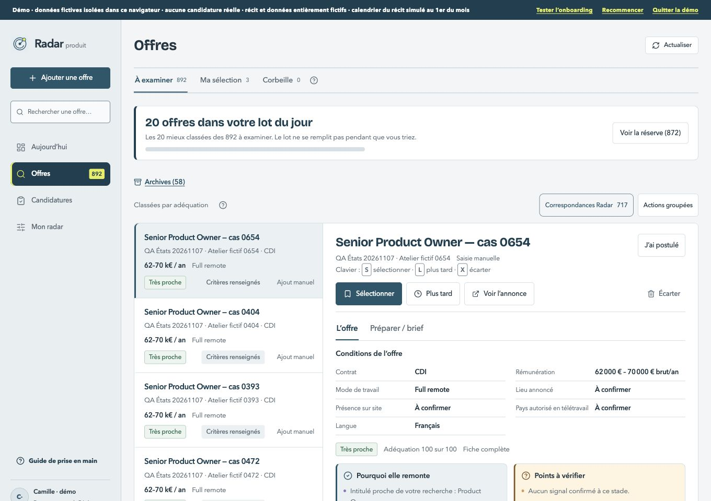
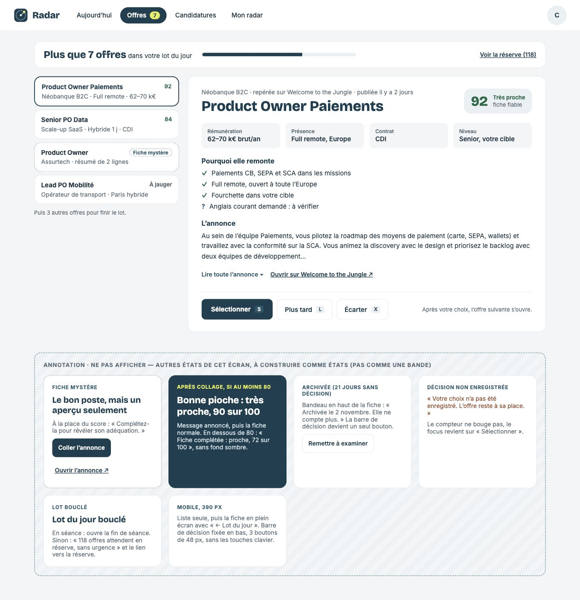
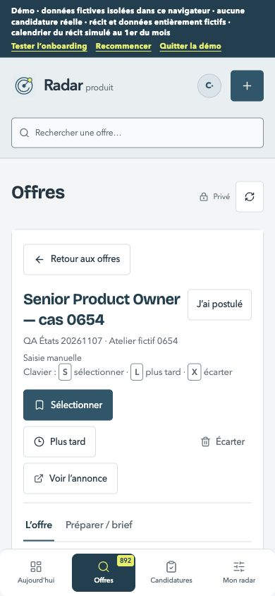
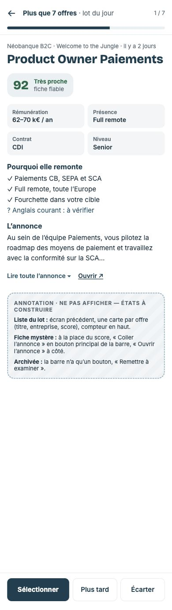

# Offres — grille préalable

Comparaison du staging 86, avant tout changement applicatif. Références : Offre-fiche.html et, à 390 px, Offre-mobile.html. Les annotations hachurées ne sont jamais rendues.

| Format | Avant | Maquette |
| --- | --- | --- |
| 1360 px |  |  |
| 390 px |  |  |

1. [x] Navigation horizontale Signal et liste de cartes séparées, colonne 340 px, intervalle 20 px ; outils existants conservés dans une zone compacte.
2. [x] Fiche : source et publication avant le titre, titre 34/28 px, adéquation près du titre ; quatre informations clés, autres conditions et dates accessibles en repli.
3. [x] Pourquoi elle remonte : raisons et réserves réelles ; annonce en aperçu puis lecture complète, correction et préparation accessibles.
4. [x] Décisions regroupées à gauche sur ordinateur, comme Offre-fiche.html ; en bas de fiche : barre ancrée sur ordinateur et fixe sur mobile, trois boutons de 52 px sur mobile ; raccourcis conservés sur ordinateur. Préserver le défilement validé et le passage à la suivante après confirmation seulement.
5. [x] Fiche mobile plein écran : retour au lot, progression réelle, aucun menu global au-dessus de la fiche. Liste et fiche sont deux vues du même écran.
6. [x] Fiche mystère remplace le score : coller et ouvrir ; révélation annoncée après sauvegarde, moment Bonne pioche si très proche et score au moins 80, confirmation sobre sinon.
7. [x] Archives : date calculée et une seule décision Remettre à examiner ; échec de décision : offre et compteur inchangés, message et focus sur Sélectionner ; lot terminé sans pression.
8. [x] Tous les états : chargement, erreur, vide, beaucoup de données et textes longs ; captures ordinateur/mobile ; clavier, focus, mouvement réduit, 44 px, aide au plus 120 mots, tests/types et absence de nouvelle erreur ESLint, console et données fictives conservées.

Choix explicites : les libellés du score v2 (Très proche, Proche, À jauger, Loin, Fiche incomplète) restent visibles avec le score réel, même si la maquette montre parfois seulement un nombre. Les nombres, dates et sources illustratifs ne sont jamais copiés. La barre mobile est fixe comme prescrit par les annotations. Les actions supplémentaires existantes restent accessibles en repli. Aucun comportement de candidature ni donnée enregistrée ne change dans ce lot.

## Choix motivés

- Les quatre informations clés et les données d’adéquation sont calculées depuis l’offre réelle. Un score sans niveau ou missions suffisants reste « Fiche incomplète », sans grand nombre trompeur.
- Le titre de page, les vues Ma sélection / Archives / Corbeille et la recherche repliable restent accessibles : la maquette illustre seulement un lot ouvert. La barre mobile comporte trois décisions de 52 px ; l’archive n’en garde qu’une et la fiche mystère propose le collage et le lien externe.
- Le défilement déjà validé est conservé : la page remonte jusqu’aux panneaux, puis chaque panneau défile. Les décisions restent ancrées en bas du panneau et regroupées à gauche sur ordinateur, comme la maquette. Les libellés clavier ne sont visibles que sur ordinateur.
- L’aperçu est réellement limité pour le lecteur d’écran aussi ; l’annonce intégrale et les autres conditions restent dépliables. La préparation et les corrections ne disparaissent pas.
- **Écart de comportement avec la carte « Lot bouclé »** : une séance existante peut contenir, après le tri, une relance, un entretien ou le carnet. Le lot terminé ne coupe pas ces étapes ; les commandes de séance permettent de continuer ou de terminer avec la confirmation existante. Forcer sa fin ferait perdre le parcours prévu par P2.

## Recette

Recette terminée sur le staging privé 94 (source `3e6db6b27f0cb46ccfce718c30e2953b2ea9b20d`) : captures ordinateur 1360 × 960 et mobile 390 × 844 dans [la comparaison](comparaison.html). Les images d’avant proviennent du staging 86 ; seuls les écrans principaux avaient été capturés avant le code, les états secondaires sont documentés après réalisation, sans reconstitution présentée comme une ancienne capture.

Les captures de lecture, éditeur, révélations et archive sont renouvelées sur 92 ; les décisions regroupées à gauche, l’erreur, le lot bouclé, la réserve et la lecture en erreur sont revérifiés sur 93. La différence 92 → 93 est le regroupement des actions sur ordinateur demandé pendant la recette. L’erreur de lecture est contrôlée sur 94, avec le squelette remplacé par l’erreur. Tous les états ont été contrôlés avec les mêmes composants ; aucune annotation hachurée n’est rendue. Une séance à plusieurs étapes reste volontairement ouverte après son lot, comme expliqué plus haut.

Vérifications : 428 tests passent, types sans erreur, aucune nouvelle erreur ESLint par rapport au relevé antérieur ; navigation clavier dans l’ordre visible, focus du collage sur le descriptif, focus d’échec sur Sélectionner, trois cibles mobiles de 52 px, titres 34 / 28 px, moment 40 / 28 px, absence de débordement avec un titre de 180 caractères. Les aides du lot sont raccourcies et celles de la réserve repliées.

Le lot de sept offres est identique après rechargement ; un échec laisse ses sept offres et le compteur inchangés. Après sélection, plus tard et écartement, le lot finit sur fond blanc et propose sa réserve sans urgence. La confirmation « Proche · 64 sur 100 » reste sobre ; « Bonne pioche · 100 sur 100 » utilise SignalMoment après enregistrement confirmé. Une archive n’a qu’une action de restauration ; la restauration a été confirmée.

Le jeu principal conserve exactement ses 1 003 offres, 50 candidatures, deux fichiers, profil, tableau, semaine et continuité. Les réglages et compteurs des sources sont identiques ; seuls lastSyncedAt / lastAttemptAt / updatedAt des deux lectures automatiques ont avancé, conformément à l’actualisation silencieuse existante. Les écritures de recette utilisent un autre compte fictif. Les échecs HTTP 503 délibérément injectés sont propres à la recette ; la console en usage normal est contrôlée séparément.

Accès de recette : relais local d’authentification vers le staging privé, sans transformation du HTML, des ressources ou des API. Aucune donnée de production, migration, modification d’accès ou publication en production. Les données des captures sont entièrement fictives.

Les contrôles structurés et dimensions des quarante captures sont dans [verification.json](verification.json).
