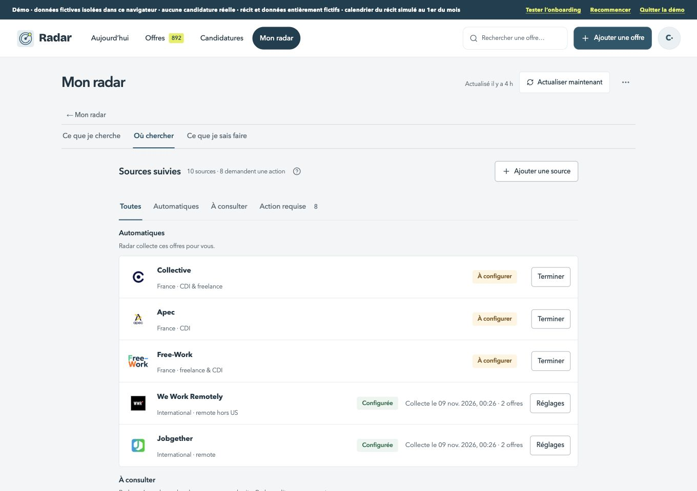
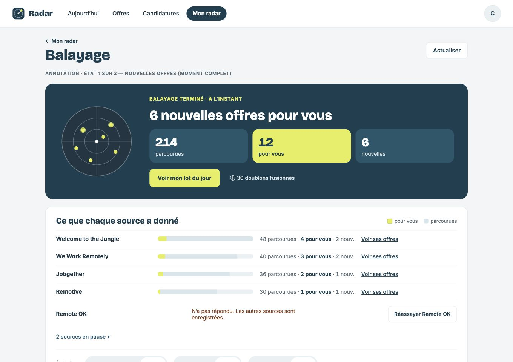
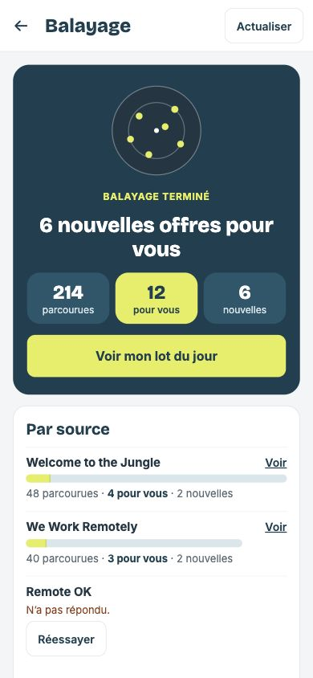

# Sources détaillées — grille avant code

Existant : staging privé 113, après #269. Il n’y a pas de maquette dédiée aux réglages détaillés. Balayage fournit la référence de colonne, hiérarchie et commandes ; les parcours existants de Sources font foi pour les états et leurs actions.

| Format | Avant | Référence Signal |
| --- | --- | --- |
| 1360 px |  |  |
| 390 px |  |  |

1. [ ] Une seule hiérarchie : retour « ← Mon radar », titre « Sources » et contenu sur la même colonne. Les anciens onglets Mon radar disparaissent de cette sous-vue ; menu horizontal / barre basse inchangés. Avatar dans l’en-tête à 390 px, commande d’actualisation secondaire et réglages à droite.
2. [ ] Liste : titre et compte dissociés, surfaces blanches de rayon 16, lignes 10, filtres et états 999. Titres de page 40/28, sections 24/20. Les textes longs se replient dans leur colonne. Une ligne d’aide par groupe, détails derrière ⓘ. Garder toutes les catégories et la distinction « automatique », « à consulter », action requise, en pause et échec.
3. [ ] Ajouter une source reste l’action principale de la liste, unique. Catalogue et fiche gardent leur contenu, sections et recherche, avec fermeture en français, actions de 44 px et contrôles Signal. Panneau de 20 px sur ordinateur ; plein écran sur mobile. Lien ou choix de réglage secondaire ; suppression conserve sa confirmation.
4. [ ] Rendre lisibles et capturer : chargement, liste vide, liste remplie et filtrée, erreur et reprise, fiche automatique, manuelle, en pause, réglages ouverts, catalogue et confirmation de retrait. Tester la navigation clavier et le retour du focus, une visite et un réglage sur un compte de recette dédié. Démo sans collecte réelle et actualisation automatique silencieuse conservée.
5. [ ] Captures avant, après et références à 1360/390. Tests, types, ESLint, console, cibles 44 px, aide ≤120 mots visibles et comparaison des données fictives. Staging privé vérifié, guide, changelog et plan à jour.

Avant : [fiche automatique ordinateur](avant-fiche-ordinateur.jpg) · [mobile](avant-fiche-mobile.jpg) ; [fiche manuelle ordinateur](avant-manuelle-ordinateur.jpg) · [mobile](avant-manuelle-mobile.jpg) ; [réglages de la fiche ordinateur](avant-reglages-ordinateur.jpg) · [mobile](avant-reglages-mobile.jpg) ; [catalogue ordinateur](avant-ajout-ordinateur.jpg) · [mobile](avant-ajout-mobile.jpg) ; [actualisation ordinateur](avant-actualisation-ordinateur.jpg) · [mobile](avant-actualisation-mobile.jpg).

Les avertissements requis (validation, suppression, flux non lu, cible géographique) gardent leur sens. Aucun connecteur, règle de collecte, mode de source ou format enregistré ne change.
