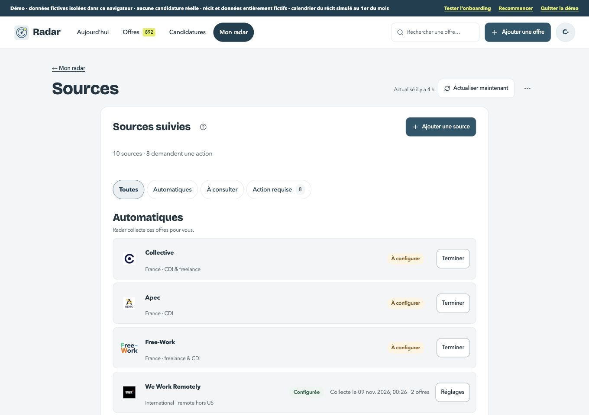

# Sources détaillées — grille et recette

Existant : staging privé 113, après #269. Il n’y a pas de maquette dédiée aux réglages détaillés. Balayage fournit la référence de colonne, hiérarchie et commandes ; les parcours existants de Sources font foi pour les états et leurs actions.

| Format | Avant | Après | Référence Signal |
| --- | --- | --- | --- |
| 1360 px |  |  |  |
| 390 px |  |  |  |

1. [x] Une seule hiérarchie : retour « ← Mon radar », titre « Sources » et contenu sur la même colonne. Les anciens onglets Mon radar disparaissent de cette sous-vue ; menu horizontal / barre basse inchangés. Avatar dans l’en-tête à 390 px, commande d’actualisation secondaire et réglages à droite.
2. [x] Liste : titre et compte dissociés, surfaces blanches de rayon 16, lignes 10, filtres et états 999. Titres de page 40/28, sections 24/20. Les textes longs se replient dans leur colonne. Une ligne d’aide par groupe, détails derrière ⓘ. Garder toutes les catégories et la distinction « automatique », « à consulter », action requise, en pause et échec.
3. [x] Ajouter une source reste l’action principale de la liste, unique. Catalogue et fiche gardent leur contenu, sections et recherche, avec fermeture en français, actions de 44 px et contrôles Signal. Panneau de 20 px sur ordinateur ; plein écran sur mobile. Lien ou choix de réglage secondaire ; suppression conserve sa confirmation.
4. [x] Rendre lisibles et capturer : chargement, liste vide, liste remplie et filtrée, erreur et reprise, fiche automatique, manuelle, en pause, réglages ouverts, catalogue et confirmation de retrait. Tester la navigation clavier et le retour du focus, une visite et un réglage sur un compte de recette dédié. Démo sans collecte réelle et actualisation automatique silencieuse conservée.
5. [x] Captures avant, après et références à 1360/390. Tests, types, ESLint, console, cibles 44 px, aide ≤120 mots visibles et comparaison des données fictives. Staging privé vérifié, guide, changelog et plan à jour.

Avant : [fiche automatique ordinateur](avant-fiche-ordinateur.jpg) · [mobile](avant-fiche-mobile.jpg) ; [fiche manuelle ordinateur](avant-manuelle-ordinateur.jpg) · [mobile](avant-manuelle-mobile.jpg) ; [réglages de la fiche ordinateur](avant-reglages-ordinateur.jpg) · [mobile](avant-reglages-mobile.jpg) ; [catalogue ordinateur](avant-ajout-ordinateur.jpg) · [mobile](avant-ajout-mobile.jpg) ; [actualisation ordinateur](avant-actualisation-ordinateur.jpg) · [mobile](avant-actualisation-mobile.jpg).

Les avertissements requis (validation, suppression, flux non lu, cible géographique) gardent leur sens. Aucun connecteur, règle de collecte, mode de source ou format enregistré ne change.

Staging privé **114**, source Sites `40a5f2b78ed6ced52590b8526cdb18bfdcdb2631`.

| État | 1360 px | 390 px |
| --- | --- | --- |
| Chargement | [Ordinateur](apres-chargement-ordinateur.jpg) | [Mobile](apres-chargement-mobile.jpg) |
| Vide / filtré | [Vide](apres-vide-ordinateur.jpg) · [Filtré](apres-filtre-ordinateur.jpg) | [Vide](apres-vide-mobile.jpg) · [Filtré](apres-filtre-mobile.jpg) |
| Erreur / reprise | [Erreur](apres-erreur-ordinateur.jpg) · [Reprise](apres-reprise-ordinateur.jpg) | [Erreur](apres-erreur-mobile.jpg) · [Reprise](apres-reprise-mobile.jpg) |
| Fiche automatique | [Fiche](apres-fiche-ordinateur.jpg) · [Réglages](apres-reglages-ordinateur.jpg) · [Pause](apres-pause-ordinateur.jpg) | [Fiche](apres-fiche-mobile.jpg) · [Réglages](apres-reglages-mobile.jpg) · [Pause](apres-pause-mobile.jpg) |
| Fiche manuelle | [Fiche](apres-manuelle-ordinateur.jpg) · [Visite](apres-visite-ordinateur.jpg) | [Fiche](apres-manuelle-mobile.jpg) · [Visite](apres-visite-mobile.jpg) |
| Actualisation silencieuse | [Ordinateur](apres-automatique-ordinateur.jpg) | [Mobile](apres-automatique-mobile.jpg) |
| Catalogue / actualisation / retrait | [Catalogue](apres-ajout-ordinateur.jpg) · [Actualisation](apres-actualisation-ordinateur.jpg) · [Retrait](apres-retrait-ordinateur.jpg) | [Catalogue](apres-ajout-mobile.jpg) · [Actualisation](apres-actualisation-mobile.jpg) · [Retrait](apres-retrait-mobile.jpg) |

- Les filtres s’activent au clavier, le catalogue s’ouvre sur « À consulter » depuis le choix vide, et Échap ramène le focus à l’ouverture. Le retrait demande confirmation, avec focus sur Annuler ; aucun retrait effectué sur le compte de référence.
- Une visite fictive est marquée, la fréquence hebdomadaire est enregistrée, et un flux fictif passe en pause. Le 503 de lecture est simulé puis levé : la reprise replace le focus sur « Sources suivies ». Sur une troisième démo, « Actualisé à l’instant » apparaît sans quitter Sources : cinq lectures réussies, une tentative en panne. La panne transitoire se voit dans Balayage ; l’état « Erreur » de la liste reste réservé aux sources dégradées. Le scénario fictif ne dégrade pas la source, donc la fiche dégradée n’a pas été capturée.
- À 390 px : retour, titre et liste commencent à 16 px ; aucune commande de la liste sous 44 px, pas de débordement horizontal. L’aide visible est sous 120 mots ; les mentions de collecte et de retrait sont conservées.
- 435 tests réussis, TypeScript vert, aucune nouvelle erreur ESLint et console vide. Comparaison des offres, candidatures, documents, profil, carnet, sources et journal de référence : identiques.
