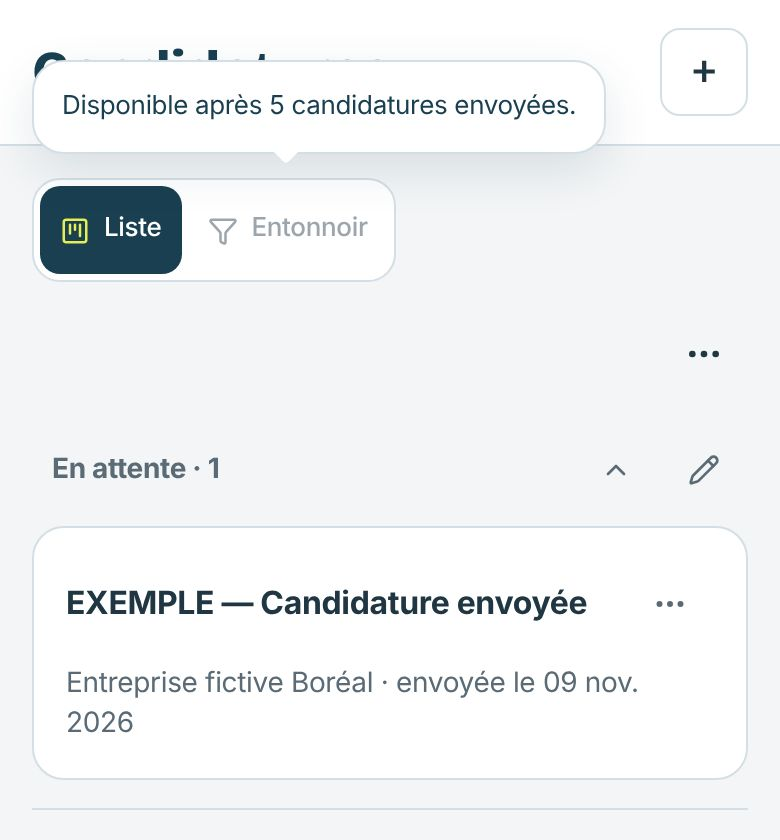
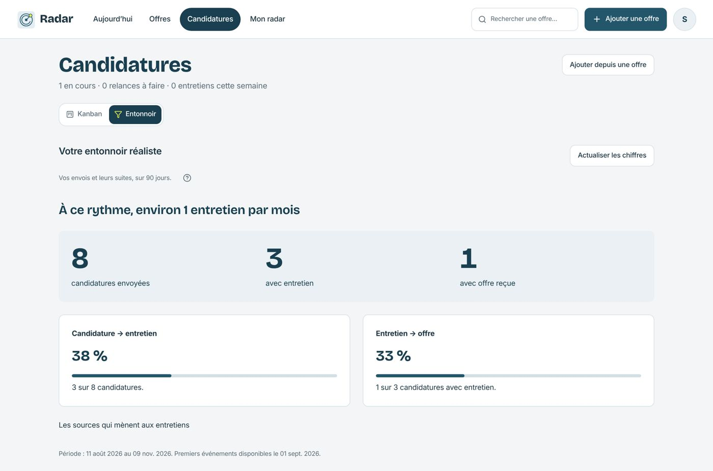
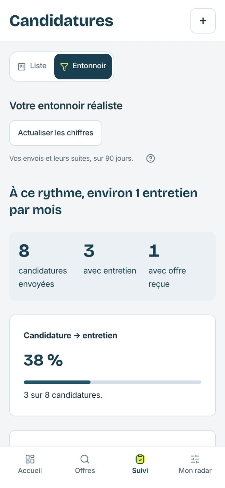

# Candidatures — bascule Kanban / Entonnoir

Le bloc « Encore N candidatures pour voir votre entonnoir » et sa modale prenaient de la place pour dire qu’il n’y avait rien à voir. Une bascule les remplace.

| État | 1360 px | 390 px |
| --- | --- | --- |
| Entonnoir verrouillé, aide ouverte |  |  |
| Entonnoir affiché (réponse simulée) |  |  |

Vérifications locales : aide au survol (ordinateur) et au toucher (mobile), description lue par les lecteurs d’écran, clic sur l’entonnoir verrouillé sans effet, bascule et retour, choix gardé au rechargement, cibles de 44 px sur mobile, aucun débordement, console vide.
