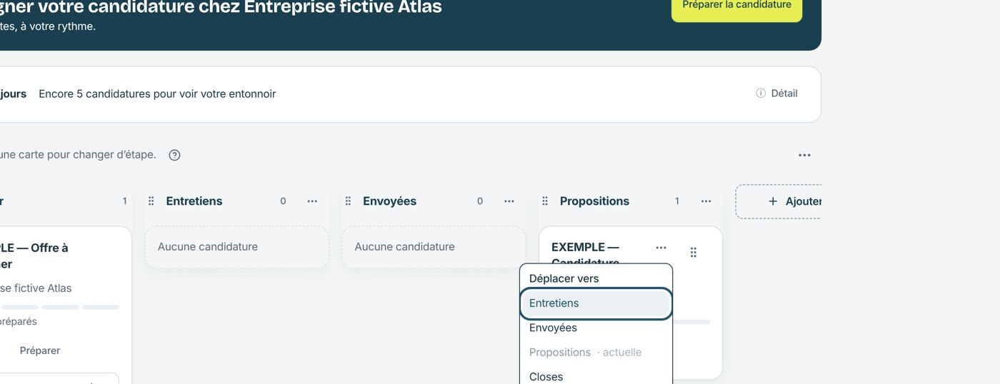

# Kanban — « Déplacer vers » dans le menu ⋯ de la carte

Le sélecteur toujours visible disparaît des cartes. « Déplacer vers » reste accessible au clavier et aux lecteurs d’écran dans le menu ⋯ (alternative au glisser-déposer exigée par WCAG 2.5.7).
