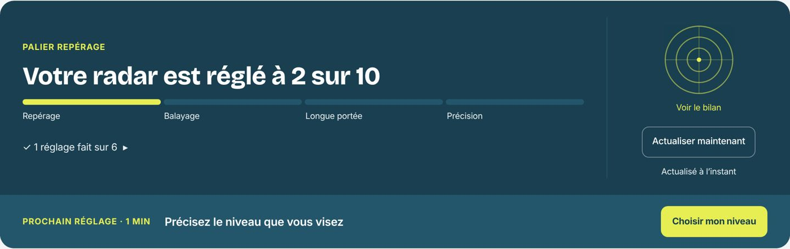
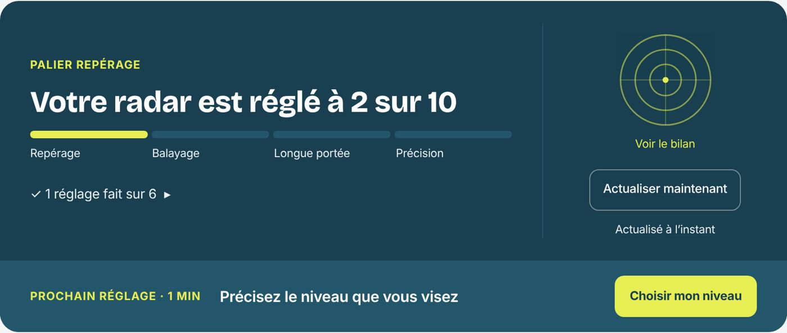
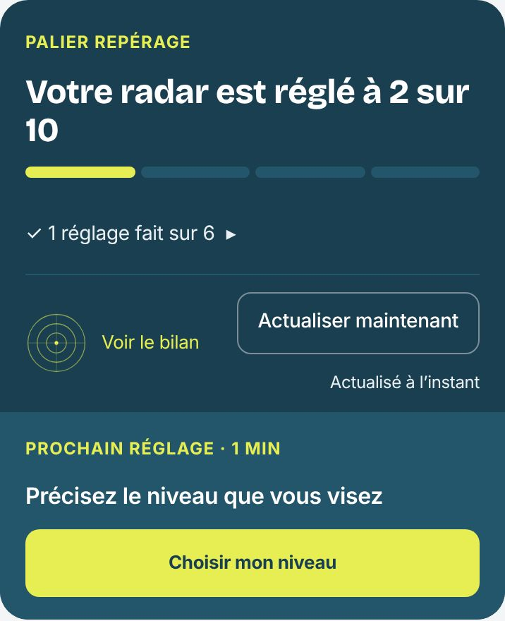

# Mon radar — portée en trois zones

Piste B validée par Lucile : progression à gauche, radar et actualisation à droite, prochain réglage dans un bandeau en bas avec la seule action principale.

| 1360 px | 900 px | 390 px |
| --- | --- | --- |
|  |  |  |
