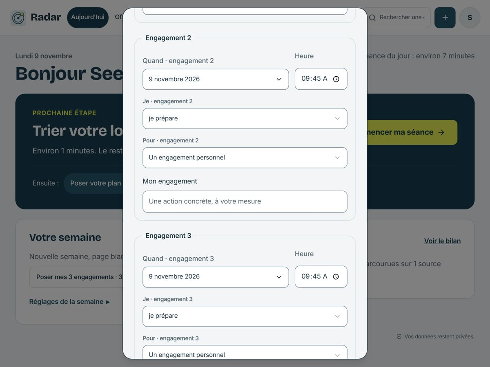
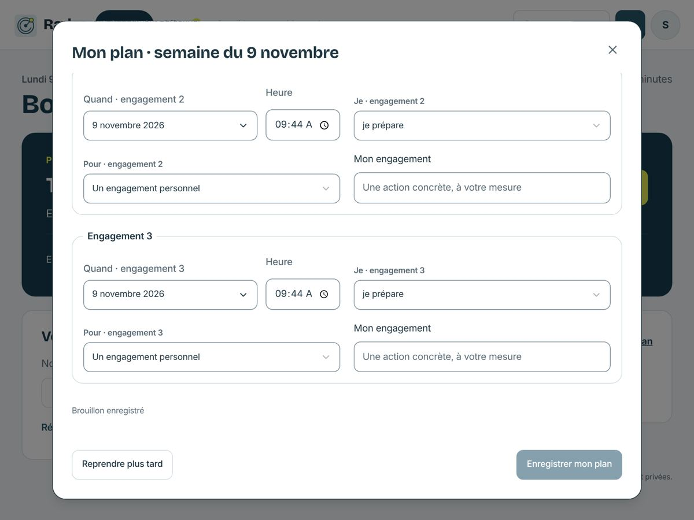
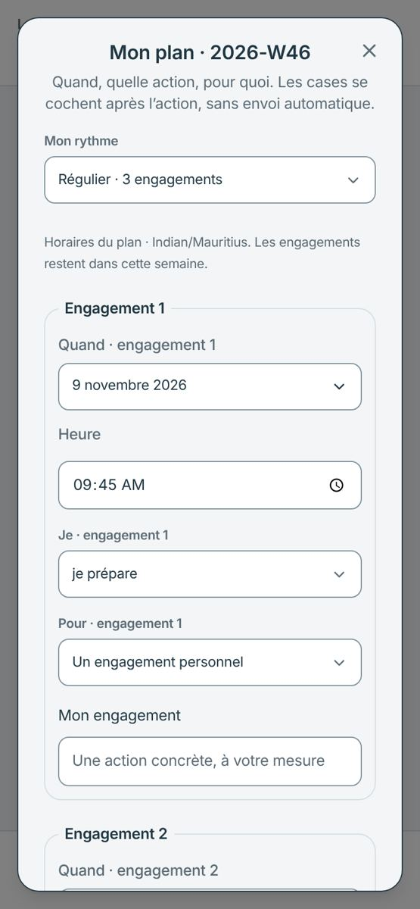
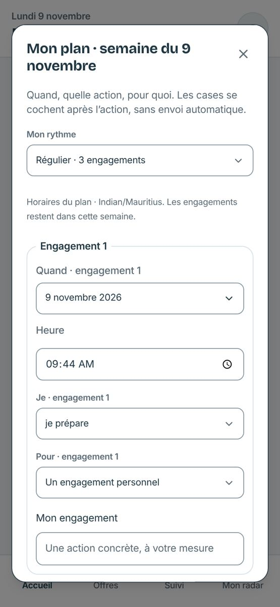

# Plan de la semaine — modale alignée sur la fiche candidature

| État | Avant | Après |
| --- | --- | --- |
| 1024 × 768, après défilement |  |  |
| 390 px, ouverture |  |  |

Mesures locales : avant, 512 px de large et 16 px du haut, croix hors champ après défilement, titre « Mon plan · 2026-W46 ». Après, 870 px au plus avec les mêmes marges que la fiche candidature (92 % de la hauteur), titre et croix visibles au défilement, « Mon plan · semaine du 9 novembre ».
