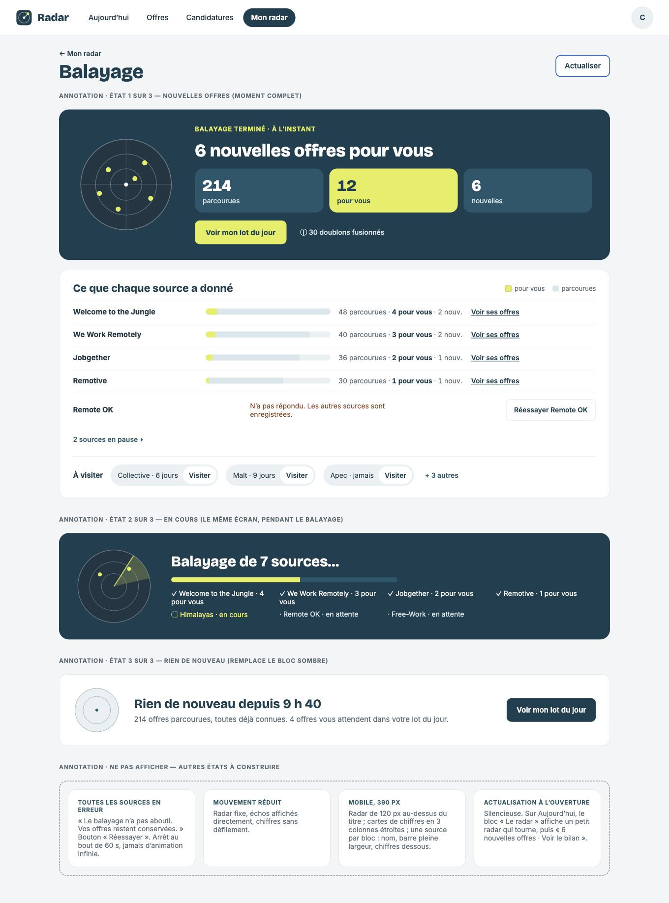

# Q2b — grille d’écarts avant code

Références : [ordinateur](../maquettes/iteration-2/Balayage-v2.html) et [mobile faisant foi à 390 px](../maquettes/iteration-2/Balayage-mobile.html), #257, #259 et #260 fusionnées. Les annotations ne sont pas affichées : les trois rendus se remplacent. Existant : staging privé version 80, données fictives. Grille arrêtée avant modification applicative.

| Format | Actuel | Maquette |
| --- | --- | --- |
| Ordinateur 1360 px |  |  |
| Mobile 390 px |  |  |

1. [ ] **Structure et colonne** : retour avant le titre sur ordinateur, retour/titre/Actualiser sur une ligne mobile, alignés sur le contenu ; bilan puis sources et visites, maximum 1120 px de contenu. Navigation latérale actuelle remplacée, sur Balayage seulement, par l’en-tête horizontal de la maquette ; mêmes quatre destinations et menu du compte.
2. [ ] **Trois états** : moment pétrole pendant la lecture et avec nouvelles offres ; bilan calme clair sans nouveauté ; trois compteurs seulement dans le moment (parcourues / pour vous / nouvelles), doublons derrière ⓘ.
3. [ ] **Radar** : balayage arrêté à la fin ; un écho persistant par offre unique correspondant aux critères, pulsation courte pour les nouvelles ; texte « Balayage terminé · N offres collent à vos critères » ; mouvement réduit statique.
4. [ ] **Lecture progressive** : états attente / en cours / terminé / erreur par source, progression globale N sources sur M, résultats dès leur arrivée, reprise ciblée sans effacer les succès ; arrêt au plus à 60 s.
5. [ ] **Barres** : tri décroissant par offres pour vous ; longueur relative aux offres parcourues ; segment citron pour les offres correspondant aux critères ; chiffres alignés, texte équivalent et lien « Voir ses offres » vers Offres filtrées exactement sur cette source.
6. [ ] **Replis** : sources en pause ou non activées repliées ; trois visites au plus, ancienne visite d’abord, jamais visitées en premier ; « + N autres » ; bouton « Visiter » nommé dans son aria-label.
7. [ ] **Jetons** : titres Bricolage ≤40/28 px, interlettrage ≥−0,01em ; rayons 20/16/10/999 ; espacements de la maquette ; un bouton principal par zone ; citron sans texte sur clair, corail absent hors célébration.
8. [ ] **États de la bande** : toutes les sources en erreur avec Réessayer et conservation des données ; mouvement réduit ; mobile 390 px (radar 120 px au-dessus, trois compteurs, source nom/barre/chiffres) ; actualisation à l’ouverture silencieuse.
9. [ ] **Accessibilité et preuves** : statuts de chaque source en aria-live polite, chiffres hors annonces ; clavier, focus, cibles mobiles 44 px ; aide ≤120 mots ; captures des états ; tests tri/repli/états, tests et types verts, aucune nouvelle erreur ESLint ni erreur console ; données fictives d’origine intactes.

## Choix explicites, comportement et accessibilité

- La maquette présente sept sources automatiques fictives ; le produit n’en prend en charge que deux. Le bilan montre uniquement les sources réellement lues, sans inventer de collecteur ni de compteurs.
- La maquette mobile dédiée fait foi à 390 px : titre 24 px, radar 120 px centré, compteurs en trois colonnes, sources et visites en blocs distincts. Les contrôles restent à 44 px pour l’accessibilité demandée.
- La maquette place six échos pour douze offres « pour vous ». La demande explicite impose un point par offre unique : le radar suit les identifiants réellement reçus.
- « N nouvelles » décrit les nouvelles fiches enregistrées ; le titre du moment précise les nouvelles correspondant aux critères. Pas de célébration si aucune nouvelle ne correspond.
- Le lien de retour revient à Mon radar ; le filtrage de source garde le lot quotidien intact et offre un effacement du filtre.
- Une visite ouvre le site sans la marquer automatiquement comme effectuée ; la confirmation existante « J’ai fait le tour » reste inchangée.
- Les lectures en cache n’inventent pas de parcours : mention « Lecture récente conservée », chiffres du parcours courant uniquement.

## Recette

À compléter après réalisation, avant fusion ; aucune case n’est considérée terminée sans vérification.
