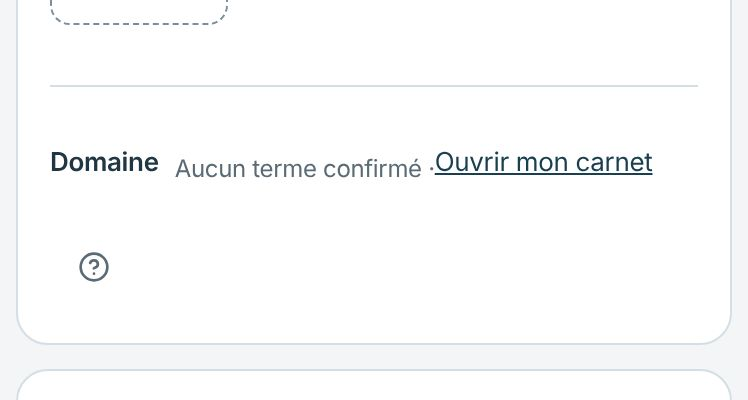
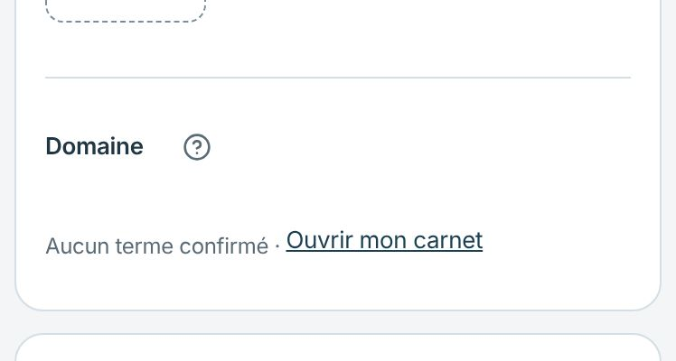
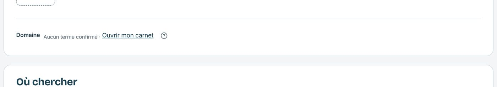
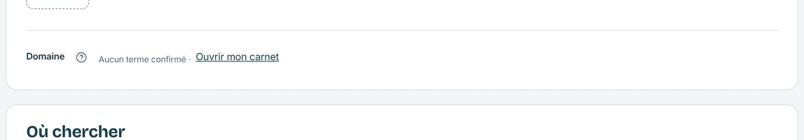
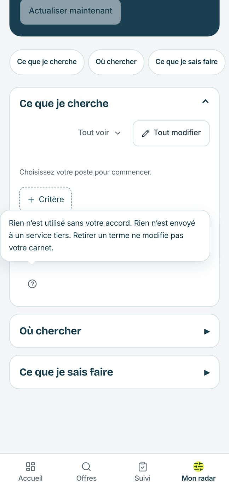
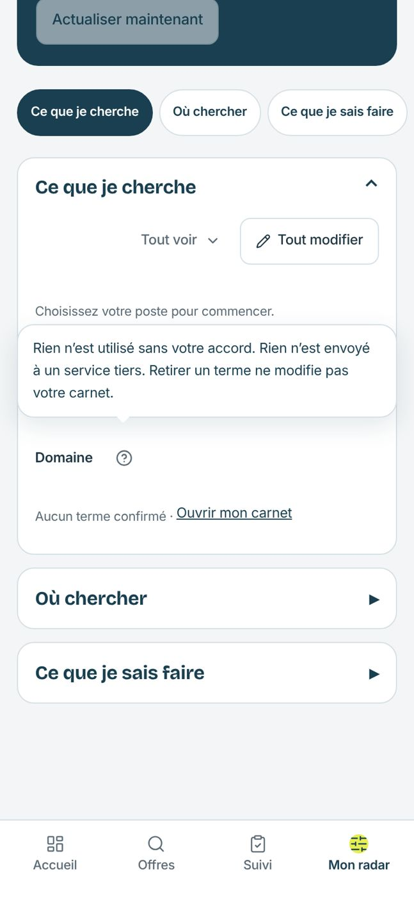

# Recette Mon radar à 390 px — aides et pastilles

Suite de la recette du staging 116, après [#271](https://github.com/Lucilesr/radar-produit/pull/271). Captures prises en local avec l’identité de démonstration, à 390 et 1360 px.

1. [x] **Aide du domaine** : à 390 px, l’aide de 44 px passait seule sur une ligne, sous « Ouvrir mon carnet ». Elle suit désormais le libellé « Domaine », comme les autres aides placées après leur titre. Même ordre au clavier et à l’écran.
2. [x] **Bulle d’aide** : elle touchait le bord gauche de l’écran. Toutes les aides gardent maintenant 16 px de marge avec les bords.
3. [x] **Pastilles** : sur mobile, une seule section est ouverte mais rien ne l’indiquait. La pastille de la section ouverte passe en pétrole et porte `aria-current`. Sur ordinateur, les trois sections restent visibles et les pastilles gardent leur aspect.
4. [x] **Séparateur** : « Aucun terme confirmé · Ouvrir mon carnet » garde une espace de chaque côté du point.

| État | Avant | Après |
| --- | --- | --- |
| Domaine, 390 px |  |  |
| Domaine, 1360 px |  |  |
| Aide ouverte, 390 px |  |  |
| Pastilles, 390 px |  |  |

Vérifications : aide ouverte au clavier et fermée avec Échap, focus rendu au bouton ; aucun débordement horizontal ; console vide ; 435 tests, types et ESLint ciblé sans erreur. Composants réutilisés : `HelpTooltip`, `DomainTermsPanel`, pastilles de `MonRadarOverview`, variables Signal. L’état avec termes confirmés n’a pas été recetté en local (aucun terme dans la démo).
