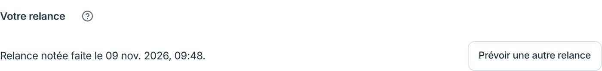
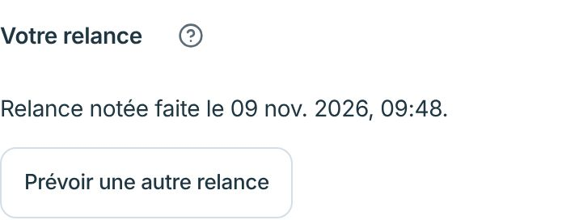
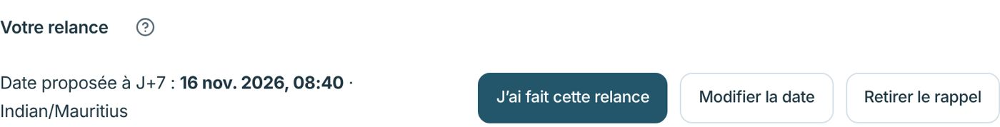

# Relance — statut et actions sur une ligne

| État | 1360 px | 390 px |
| --- | --- | --- |
| Relance faite |  |  |
| Date proposée |  | — |

Sur ordinateur, le statut reste à gauche et les actions passent à droite sur la même ligne. Sur mobile, les actions restent sous le statut.
